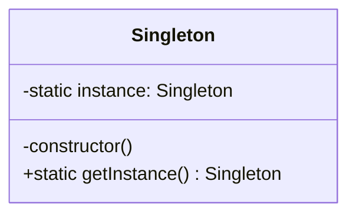

# 单例模式：从 ESM 模块缓存到全局状态管理（面试收藏级）

> **副标题**：ESM 模块天然是单例，但「天然」不等于「有设计意图」

> 面试官问：「说说单例模式。」
>
> 你很顺：「私有构造函数、静态实例字段、静态 `getInstance` 方法，三件套。」
>
> 他点点头，接着问：「那你写 `export const store = { ... }` 直接导出一个对象，是不是也是单例？」
>
> 你说：「不是，那没有 `getInstance`。」
>
> 他笑了一下：「可它全局也只有一份啊。跑十次 `import`，拿到的都是同一个对象。为什么还需要 `getInstance`？」
>
> 你愣了一下。这题不难，但你没想过「单例」和「一份」居然是两件事。

---

## 🎯 这篇文章解决什么问题

单例是 23 种模式里**最简单的一个**——简单到大部分人答完三件套就以为讲完了。

但它是真实工程里**坑最深的一个**。因为「唯一」这件事，从来不是靠一个 `getInstance` 就能保证的：

```text
你写了 getInstance 保证唯一
        ↓
但模块被打包了两份            → 两个模块作用域，两个实例
热更新重新求值了模块          → 旧引用指向旧实例，新代码拿新实例
SSR 跑在 Node 进程里          → 模块作用域是进程级，A 用户的数据被 B 用户读到
测试之间没重置全局状态        → 前一个用例改了配置，后一个用例拿到脏数据
```

所以这一篇的主线不是「怎么写出单例」，而是：

> **「唯一性」是怎么被保证的，又是怎么被悄悄破坏的。**

读完你会得到三样东西：

- **一条演进线**：六种实现从哪来、各自解决了上一版什么问题——而不是六个并列的代码块。你以后看到任何一份单例代码，都能立刻判断它处在演进的哪一步
- **一份破坏清单**：模块重复打包、HMR、SSR、多进程、测试污染，五个让「唯一」失效的真实场景
- **一个判断力**：知道什么时候**不该**用单例。这才是 5-10 年和 3 年的分水岭——前者写得出单例，后者知道哪里该绕开它

---

## 一、三个场景：为什么这些东西只能有一份

先说一个容易被忽略的事实：**「只能有一份」这个要求，从来不是来自代码，而是来自资源本身的性质。**

下面三个场景，每一个都写清「多一份会具体坏在哪」——因为「必须唯一」是句空话，面试时说不出后果，等于没理解。

### Toast 队列：第二次 new 会吞掉第一个提示

```typescript
// ❌ 每次调用都 new 一个，看起来没问题
export function toast(msg: string) {
  return new ToastManager(msg);   // 内部有自己的队列和定时器
}
```

两个提示连着弹：

```typescript
toast('处方已保存');    // 实例 A，队列 [处方已保存]，定时器 3s
toast('库存不足');      // 实例 B，队列 [库存不足]，定时器 3s
```

用户看到的是：**「处方已保存」闪了一下就消失，只剩「库存不足」。**

因为两个 `ToastManager` 各自算自己的高度、各自挂自己的 `setTimeout`、各自操作同一个 `position: fixed` 的容器。第二个实例把自己定位在 `top: 20px` 时，正好盖住了第一个。

**这里的「唯一」不是审美要求，是因为它们抢同一个物理位置。**

### PermissionConfig：两份配置 → 看得见入口，点进去 403

```typescript
//❌ 路由守卫读一份
const guardConfig = new PermissionConfig();

//❌ 按钮级指令读另一份
const buttonConfig = new PermissionConfig();

// 时机不同、请求不同，两份配置可能一个拿到了 `prescription:write`
// 另一个还没拿到（或者拿到了旧版本）
```

结果是最难排查的一类 bug：**用户能看见「开处方」按钮，点下去后端返回 403。**

因为「能不能看见」和「能不能点」是两套判定，各自读了一份不同的配置快照。

**这里的「唯一」要求，本质是「同一个事实只能有一个版本」。**

### WS 连接管理器：重复连接被服务端踢线

```typescript
// ❌ 每个用到的地方都自己连一次
const ws = new WsManager(userId);
ws.connect();
```

服务端通常有「同一用户只允许一条连接」的策略，新连接进来就踢掉旧的。于是表现为：**页面时不时莫名其妙掉线，日志里两条连接互踢。**

这个坑在单页应用里特别隐蔽——路由切换时组件重建，如果 `WsManager` 是在组件里 `new` 的，每切一次路由就多一条连接。

**这里的「唯一」要求，来自「外部资源只允许一个持有者」。**

### 再加上两个你天天在用的

- **Redux / Zustand 的 store**：整个应用共享同一个 state 树。如果两个组件各自 `createStore`，改 A 的 store 不会触发 B 的视图更新——这就是「状态不同步」的经典现场
- **axios 实例**：`baseURL`、超时、拦截器只配一遍。多次 `axios.create()` 各自带一套拦截器，会出现「同一个请求被加了两次 token header」

把上面五个场景归结一下，你会发现背后只有两类资源：

| 资源类型 | 例子 | 多一份的后果 |
| --- | --- | --- |
| **抢外部唯一资源的** | Toast 容器、WS 连接、全局 socket | 互相覆盖、互踢、视觉错乱 |
| **承载唯一事实的** | 权限配置、store、axios 配置 | 数据不同步、配置冲突、排查极难 |

> 💬 **面试官**：为什么 Toast 要做成单例？
>
> ✅ 标准答案：因为 Toast 抢占的是**同一个物理位置**和**同一套视觉队列**。多个 ToastManager 实例各自维护自己的队列和定时器，但都操作同一个 `position: fixed` 容器、都算同一套 `top` 偏移，于是第二个实例会覆盖第一个的位置，表现为「前一个提示被吞掉」。这不是设计偏好问题，是资源和位置唯一性决定的。
>
> 🎁 加分答案：能把这个判断推广成一条通用标准——**判断要不要单例，看这个资源是不是「外部唯一」的**：唯一的位置、唯一的连接、唯一的事实版本、唯一的配置。反过来说，如果一个对象只是「用起来方便、想全局拿到」，那不叫单例需求，那是**图省事的全局变量**——这两者的分界，就是这篇第七章要讲的「单例什么时候变成技术债」。

---

## 二、意图与本质：唯一性 + 全局访问点

### 意图

> **确保一个类只有一个实例，并提供全局访问点。**

这句话有两个半句，很多人只记住了第一个。

而且这两半的价值是**分家的**——唯一性是好东西，全局访问点在今天的工程实践里越来越被当成负担。第七章会把这条说透，这里先埋一个判断：

> **单例被诟病的地方，几乎全在「全局访问点」这半句上，而不是「唯一性」那半句。**

所以学单例要分得清：哪些内容是「怎么保证唯一」（技术），哪些是「唯一了这个东西之后，怎么不让它变成隐式依赖」（工程判断）。

### 把核心矛盾拆成两个维度

单例要同时满足两件事，而这两件事的难度根本不在一个量级：

```text
     ① 唯一性                        ② 可访问性
  全局只能有一份                   随便哪个模块都能拿到
        │                                │
        │  export const x = {} 就做到了   │  import 就做到了
        │  —— 零难度，语言层自带          │  —— 零难度
        └──────────────┬─────────────────┘
                       ↓
              真正难的是第三件事：
         ③ 有意图 —— 让「唯一」成为不可违反的约束，
            而不是「碰巧只有一个」的巧合
```

这就是开头那个面试题的答案：`export const store = {}` 确实只有一份，但它是**「碰巧」**——因为模块只求值一次，所以恰好只有一个。这个「唯一」是**模块系统给的，不是设计给的**。

一旦模块被求值两次（打包两份、HMR 重新求值、`delete require.cache`），「唯一」就没了，而你的代码里**没有任何机制会告诉你它没了**。

单例模式要补的，就是这第三件事：

> **把「唯一」从「碰巧如此」变成「不这样就不对」。**

### 为什么它被归在「创建型」

GoF 把单例放进创建型，而不是结构型或行为型。理由在这一步就清楚了：**单例管的是「这个对象由谁创建、创建几次」**——它把实例化的控制权从「调用方」收回到「类自己」。

对比一下就明白：

```text
   普通类：调用方决定创建几个        →  谁 new 谁负责
   单例：  类自己决定只创建一个      →  创建权被上收
```

这也解释了为什么单例的前五种写法（第三版到第五版最明显）本质上都在改**实例化的入口**：

- 私有构造 → 把入口从 `new` 换成 `getInstance`
- 透明单例 → 保留 `new` 这个入口，但改掉它的语义
- 泛化工厂 → 把「入口」本身做成可复用的东西

**看单例的所有实现，都盯住「实例化入口在哪」这一件事，就不会被六种写法绕晕。**

### 三个要素，缺一个会怎样

三要素缺一不可，但「缺了会怎样」比「有哪些」重要得多。这里逐个试一遍：

```typescript
class PrescriptionWsManager {
  private static instance: PrescriptionWsManager | null = null;
  private constructor() {}
  static getInstance(): PrescriptionWsManager {
    if (!PrescriptionWsManager.instance) {
      PrescriptionWsManager.instance = new PrescriptionWsManager();
    }
    return PrescriptionWsManager.instance;
  }
}
```

**要素一：私有构造函数 `private constructor()`**

去掉它，任何人可以直接 `new PrescriptionWsManager()`——`getInstance()` 还能用，但唯一性形同虚设。

```typescript
const a = PrescriptionWsManager.getInstance();
const b = new PrescriptionWsManager();   // ❌ 报 TS2673
```

TypeScript 会在编译期拦住它，报 `TS2673: Constructor of class 'PrescriptionWsManager' is private and only accessible within the class declaration`。

**注意这个错误的实际价值**：它是**编译期**的强制，不是靠文档约定。这一点在第七章「单例为什么难测」时会变成双刃剑——私有构造让「测试时造一个干净的实例」也变成了难事。

**要素二：静态私有实例字段 `private static instance`**

去掉它（改成每次 `getInstance` 都 `new`），`getInstance` 就退化成了一个工厂方法，不再有唯一性。

**要素三：静态访问点 `static getInstance()`**

去掉它，你只能靠导出实例来提供访问——那就回到了「碰巧唯一」，回到第二章开头那个困境。

---

## 三、结构与角色：一张类图 + 一张原图

单例的角色只有一个，简单到不需要 UML 也能说清——但正因为简单，两个细节最容易被画错。




对照图看三个符号细节，这是面试白板上最容易画错的地方：

| 类图元素 | 对应代码 | 画错会怎样 |
| --- | --- | --- |
| `-static instance` | `private static instance` | 下划线表示 static，减号表示 private。漏下划线 = 不是静态；写成 `+` = 不是私有 |
| `-constructor()` | `private constructor()` | 漏掉减号，面试官会以为你没意识到「私有构造才是唯一性的第一道锁」 |
| `+static getInstance()` | `public static getInstance()` | 加号 + 下划线，两者都要 |

**下划线 = static，减号 = private**——TypeScript 的 `static` 和 `private` 在类图上正好是两个独立标注，缺一个语义就变了。这也是第 00 篇那张「类图速查表」里 `+ / - / #` 的实际用法。

### 为什么单例的类图这么「空」

看一眼上面这张图，你可能会有个疑问：**23 种模式里，为什么单例的类图只有一个框？**

因为它确实是唯一一个**只涉及一个类**的模式。

- 策略、装饰器、观察者——至少两个角色（接口 + 实现，或被装饰者 + 装饰者）
- 工厂方法——至少两个（Creator + Product）
- 单例——就一个。它没有「协作对象」，它约束的是**这个类自己的实例数量**

这个「空」带来两个实际后果，值得记一下：

**后果一：面试时容易被追问下一步。** 面试官看到你画出这个简单的类图，通常会立刻往下走——「那你项目里哪里用了？」「它有什么问题？」这两问才是真正的考点，因为画图无法区分做过和背过。这也是本篇为什么第七章（代价）比第三章（结构）长十倍的原因：**结构部分的信息量本来就小，硬讲就是注水。**

**后果二：单例常常和其他模式组合出现。** 单独的 `getInstance` 没什么用，真正有用的是「单例 + 观察者」（全局 store）、「单例 + 工厂」（全局配置工厂）、「单例 + 门面」（全局 SDK 入口）。所以看到单例设计时，别只看它自己，要看**它和谁一起工作**——下一篇讲工厂模式时，会看到「单例工厂」这个组合。

---

## 四、核心实现：六种写法，一条演进线

这一章是全篇重心。**不要把它们当成六个并列的方案来背**——它们是一条演进线，每一版都在回答「上一版哪里不够」。

记住这条线，你以后看任何单例代码都能定位它在第几步：

```text
 ① ES6 静态  ──▶ 唯一性有了，但使用者必须知道「要调 getInstance」
 ② ES5 静态  ──▶ 没有 class 语法时怎么办（唯一性一样，接口一样别扭）
 ③ 透明单例  ──▶ 使用者照常 new，不用知道是单例
 ④ 构造分离  ──▶ 构造和取实例解耦，职责更干净
 ⑤ 泛化工厂  ──▶ 一套逻辑能用在任意类上
 ⑥ TS 泛型工厂 ──▶ 泛化的同时，把类型也还给了编译器
```

### 第一版：ES6 静态 —— 教科书写法

```typescript
class Window {
  private static instance: Window;
  private constructor() {}
  static getInstance() {
    if(!Window.instance) {
      Window.instance = new Window();
    }
    return Window.instance;
  }
}

const w1 = Window.getInstance();
const w2 = Window.getInstance();

console.log(w1 == w2);
```

输出 `true`。

这一版是全篇的基准。**它解决了什么**：唯一性由「私有构造 + 静态实例 + 惰性创建」三重保证，编译器帮你挡住了外部 `new`。**它还差什么**：使用者必须**知道**这是个单例，必须记得调 `Window.getInstance()` 而不是 `new Window()`。

这个「必须知道」听起来是小事，但在大团队里是真实的成本：新人接手代码时，`new Window()` 会直接编译报错，他还得去查为什么——错误信息只说「构造函数是私有的」，不说「请用 getInstance」。

### 第二版：ES5 静态 —— 没有 class 的年代

```typescript
function Window() {}
Window.prototype.hello = function() {
  console.log('hello');
}

Window.getInstance = (function() {
  let instance: Window;
  return function() {
    if(!instance) {
      instance = new (Window as any)();
    }
    return instance;
  }
})();

// 缺点：就是必须要告诉使用者通过 getInstance 方法获取单例
const w1 = Window.getInstance();
const w2 = Window.getInstance();
console.log(w1 == w2);
```

输出 `true`。这一版的精髓是那个 **IIFE + 闭包**：`instance` 活在闭包里，外部拿不到，等价于 ES6 的 `private static`。

但这一版有个 ES6 版没有的致命缺口——**它挡不住 `new`**：

```typescript
const viaGet = Window.getInstance();
const viaNew = new Window();
console.log(viaGet === viaNew);   // false
```

我实际跑了一遍，输出确认是 `false`。**单例被破了，而且没有任何报错。**

原因很直接：ES5 的函数没有「私有构造」这个概念，`new Window()` 永远合法。`getInstance` 只是「一条建议路径」，不是「唯一路径」。

这一版**解决了什么**：在没有 class 语法的环境里实现了惰性单例。**还差什么**：唯一性没有强制力（`new` 依然能破），且使用者依然得知道要调 `getInstance`。

### 第三版：透明单例 —— 让使用者无感

既然「必须知道是单例」是个缺点，那就把 `getInstance` 藏起来，让 `new` 本身就返回唯一实例：

```typescript
/**
 * 透明单例模式
 *  客户端或者说使用者不需要知道要按单例使用
 */
const Window = (function() {
  let window: Window;
  const Window = function(this: Window) {
    if(window) {
      return w1;
    } else {
      return (window = this);
    }
  }
  return Window;
})();

const w1 = new (Window as any)();
const w2 = new (Window as any)();
console.log(w1 == w2);
```

输出 `true`——而且**使用者压根不知道自己在用单例**，`new Window()` 拿到的就是唯一实例。这就是「透明」二字的含义。

**原理**：JS 的构造函数如果 `return` 一个对象，`new` 拿到的就是这个返回的对象，而不是 `this`。所以第二次 `new` 时，走 `if(window)` 分支，把第一次的实例 `return` 出去。

这一版**解决了什么**：调用方零认知负担，`new` 天然幂等。**还差什么**：这段代码**极其脆弱**。

我在本地跑的时候踩了两个坑，都值得单独说——因为它们是「透明单例到底能不能用在生产」的答案：

**坑一：它依赖外层变量名 `w1`。**

`if(window) { return w1; }` 里的 `w1` 是一个**自由变量**，指的是外面那个 `const w1`。也就是说，这段代码能跑，是因为你恰好把第一次的实例命名为 `w1`。换个名字：

```typescript
const first = new (Window as any)();
new (Window as any)();   // 走 if(window) 分支，要 return w1
```

我实际跑了这个改动，第二次 `new` 直接抛错：

```text
ReferenceError: w1 is not defined
```

**这是原代码里的一个真实缺陷**——它把「第一次的实例」和「外层某个具体变量名」绑死了。正确写法应该是 `return window;`（闭包里的那个），而不是 `return w1`。

**坑二：`return` 一个非本类的对象，会破坏 `instanceof` 和类型推断。**

上面这段之所以能过编译，是因为全程 `as any`。在 TypeScript 里做透明单例，你得和类型系统打一场注定打不赢的仗：构造函数返回的不是 `this` 类型，`new` 表达式的类型推断会错乱。

所以现实结论是：**透明单例是个绝佳的教学案例，但它不适合作为生产写法。** 它展示的是「JS 构造函数的返回机制」，不是「你该这么写单例」。

### 第四版：单例与构造分离

第三版把「取实例」藏进了构造函数里，第四版反过来——把构造函数还给它自己，把「取实例」彻底抽出去：

```typescript
/**
 * 单例与构造过程的分离
 */
function Window() {}
Window.prototype.hello = function() {
  console.log('hello');
}

const createInstance = (function() {
  let instance: Window;
  return function() {
    if(!instance) {
      instance = new (Window as any)();
    }
    return instance;
  }
})();

// 缺点：就是必须要告诉使用者通过 getInstance 方法获取单例
const w1 = createInstance();
const w2 = createInstance();
console.log(w1 == w2);
```

输出 `true`。

这一版**解决了什么**：职责分开了——`Window` 只管「我是个窗口」，`createInstance` 只管「保证只有一个」。构造函数不再被污染，不用在 `new` 里写 `if`。

**还差什么**：`createInstance` 是**为 `Window` 写死的**。下一个类（比如 `Door`）也要单例呢？再复制一遍这段 IIFE，改个名字。十个类就是十段复制——违反 DRY，也正是下一版要解决的。

### 第五版：封装变化 —— 泛化单例工厂

既然「取实例」的逻辑和具体是哪个类无关，那就把它参数化：

```typescript
/**
 * 封装变化
 */
function Window() {}
Window.prototype.hello = function() {
  console.log('hello');
}

// createInstance 可以创建任何类型的实例
const createInstance = function(Constructor: any) {
  let instance: any;
  return function(this: any) {
    if(!instance) {
      Constructor.apply(this, arguments); // 相当于调用构造函数
      Object.setPrototypeOf(this, Constructor.prototype); // 指定原型，相当于 this.__proto__ = Constructor.prototype
      instance = this;
    }
    return instance;
  }
};
```

用法：

```typescript
const CreateWindow: any = createInstance(Window);
const w1 = new CreateWindow();
const w2 = new CreateWindow();
console.log(w1 == w2);
```

输出 `true`。我又验证了两件事，因为它们是「泛化」是否真的成立的判据：

```text
[泛化工厂] w1 instanceof Window : true
[泛化工厂] typeof w1.hello : function
```

`instanceof` 成立（因为 `setPrototypeOf` 把原型接上了），原型方法 `hello` 也能用——说明它不只是「返回同一个对象」，而是「返回一个**真正的 Window 实例**」。

同一个工厂还能给别的类用：

```typescript
function Door() {}
Door.prototype.open = function() { console.log('open'); };
const CreateDoor = createInstance(Door);
const d1 = new CreateDoor();
const d2 = new CreateDoor();
console.log(d1 === d2, d1 === w1);   // true false
```

每个类各自唯一，互不串味。**这一版才真正把「单例」从一个具体实现，抽成了一个可复用的能力。**

**还差什么**：它用了 `apply` + `setPrototypeOf`，读起来绕。而且 `new CreateWindow()` 这个写法本身很怪——`CreateWindow` 其实是个「返回实例的普通函数」，你只是在用 `new` 的副作用让 `this` 有正确原型。在 TypeScript 里要写成这样，得一路 `any` 下去，类型安全全丢了。

### 第六版：现代 TypeScript 版 —— 补上第五版丢掉的全部类型

第五版的思路是对的，问题只出在类型上。今天的 TypeScript 完全可以把同一件事写得既泛化又类型安全：

```typescript
type Constructor<T> = new (...args: any[]) => T;

function singleton<T>(Ctor: Constructor<T>): () => T {
  let instance: T | null = null;
  return function (): T {
    if (instance === null) instance = new Ctor();
    return instance;
  };
}
```

用法上，`getInstance` 换成了 `singleton(Ctor)` 返回的类型安全工厂：

```typescript
class FloatPanel { hello() { console.log('hello'); } }
class Door { open() { console.log('open'); } }

const getPanel = singleton(FloatPanel);
const getDoor = singleton(Door);

const w1 = getPanel();   // 推断为 FloatPanel，不是 any
const d1 = getDoor();    // 推断为 Door
console.log(w1 === getPanel(), w1 instanceof FloatPanel);  // true true
```

我把这段实际编译跑了一遍，两点确认：

```text
same: true | instanceof: true
hello
open
```

**返回类型确实被精确推断成了 `FloatPanel` 和 `Door`，不是 `any`。** 把 `w1` 赋给 `number` 会直接报 `TS2322: Type 'FloatPanel' is not assignable to type 'number'`——说明泛型约束真的在工作，而不是靠 `any` 蒙混过去。

（顺带一个真实踩坑：这段代码我一开始把类名写成 `Window`，编译直接报 `TS2300: Duplicate identifier 'Window'`——因为默认 lib 里已经有 DOM 的 `Window`。这也是为什么示例里改叫 `FloatPanel`。**在真实项目里给单例类取名时，别撞 DOM 全局名。**）

对比第五版，这里的三个改进都是实打实的：

| | 第五版（ES5 泛化工厂） | 第六版（TS 泛型工厂） |
| --- | --- | --- |
| 调用方式 | `new CreateWindow()`（反直觉） | `getPanel()`（普通函数调用） |
| 类型 | 全是 `any` | `FloatPanel` / `Door` 精确推断 |
| 实现 | `apply` + `setPrototypeOf` | 直接 `new Ctor()`，无需手动接原型 |
| 构造参数 | 靠 `arguments` 透传 | 需要时可扩展成 `new (...args) => T` |

**第六版才是这条演进线的终点。** 它证明了前五版真正值得保留的东西不是某段代码，而是那个判断顺序：

```text
① 唯一性由谁保证？           → 闭包里的 instance
② 使用者要不要知道？          → 不需要，就是一个普通函数
③ 能不能复用到任意类？        → 能，泛型参数化
④ 类型安不安全？             → 能，泛型约束保住了返回类型
```

前五版每一版都在解决①②③中的一个，而④要等到 TypeScript 的泛型足够成熟才成为可能。**所以你背代码是没有意义的——记住这四个问题，任何语言、任何年代你都能写出对应版本。**

### 六种写法的对比

| 版本 | 唯一性靠什么保证 | `new` 还能破吗 | 使用者要知道是单例吗 | 能复用到任意类 | 主要缺点 |
| --- | --- | --- | --- | --- | --- |
| ① ES6 静态 | 私有构造 + 静态实例 | ❌ 不能（编译期报错） | ✅ 要知道 | ❌ 每类写一遍 | 使用者必须记得调 `getInstance` |
| ② ES5 静态 | 闭包 + 协议 | ✅ 能，且静默破 | ✅ 要知道 | ❌ 每类写一遍 | 无强制力 |
| ③ 透明单例 | 构造函数内判空 `return` | — （`new` 即入口） | ❌ 不需要 | ❌ 每类写一遍 | 依赖闭包变量名，类型系统难兼容 |
| ④ 构造分离 | 闭包 + 独立工厂 | ✅ 能（原构造仍可用） | ✅ 要知道 | ❌ 每类一段 IIFE | 换类要复制粘贴 |
| ⑤ 泛化工厂 | 闭包 + 参数化工厂 | — （`new` 即入口） | ❌ 不需要 | ✅ 任意类 | `apply` + `setPrototypeOf`，全 `any` 无类型 |
| ⑥ TS 泛型工厂 | 闭包 + 泛型参数 | — （函数调用即入口） | ❌ 不需要 | ✅ 任意类 | 需理解泛型；构造参数要额外处理 |

看这张表会发现一条主线：**演进的方向，是「把约束从人身上，转移到代码身上」**。

① 靠私有构造把唯一性交给编译器；③⑤ 靠重写 `new` 的行为把「要不要知道」这件事从人身上拿掉；⑤ 再往前一步，把「为每个类重复写一遍」也从人身上拿掉；⑥ 把「类型安全」这道最后的优惠也补齐了。

而 ② 和 ④ 之所以「还差一口气」，都是因为它们把最关键的那一步留给了使用者的自觉。

> 💬 **面试官**：为什么单例的构造函数要写成 private？除了 `getInstance` 还有别的写法吗？
>
> ✅ 标准答案：私有构造函数的作用是**在编译器层面堵死外部 `new` 的路径**——唯一性不只是「入口只有一个」，而是「其他入口根本不存在」。在 TypeScript 里，如果构造函数是 private，外部 `new` 会直接编译报错（`TS2673`），这让「唯一」从约定变成了强制。除了静态 `getInstance`，常见的等价写法还有两种：一是在模块层直接 `export const instance = new Xxx()`，靠模块缓存保证唯一（但没强制力）；二是透明单例，重写构造函数让它检查已有实例并 `return` 它，调用方照常 `new` 但拿到的是同一个对象。
>
> 🎁 加分答案：能指出这几种写法在「强制力」上的差异——静态私有版是**编译期强制**，模块导出是**运行时碰巧**，透明单例是**运行时强制但破坏类型系统**。再补一句工程判断：现代项目里最常用的是「模块导出一个实例 + 类保持普通」，因为它最简单、对 tree-shaking 和测试最友好，代价是唯一性只有约定没有强制。能说出「我用哪种写法取决于我想要多强的强制力」，说明你不是背了六种写法，而是理解了它们各自的边界。

---

## 五、易混淆辨析

### 模块 vs 单例：无意图的唯一，和有意图的唯一

这是本篇开头那道面试题的正面回答。

```typescript
// A 文件
export const config = { timeout: 3000 };
```

```typescript
// B、C、D 文件
import { config } from './a';
```

无论 import 多少次，`config` 都是同一个对象。从「结果」看，它就是单例。

但两者的差别在**为什么唯一**：

| | 模块导出的对象 | 单例模式 |
| --- | --- | --- |
| 唯一性来源 | 模块求值只发生一次（语言/运行时机制） | 代码显式保证（私有构造 + 静态实例） |
| 有没有强制力 | 没有——模块求值两次就有两份 | 有——外部无法 `new` |
| 能不能被绕过 | 能（`delete require.cache`、重复打包、HMR） | 不能（除非改类定义） |
| 意图 | 无。唯一是副作用 | 有。唯一是目的地 |

我用 Node 实际验证了「模块求值两次就有两份」这件事：

```text
>>> mod.js 求值了
[require 不同写法同一文件] a === b : true     ← 同一 resolved 路径，缓存命中
>>> mod.js 求值了
[删缓存后] c === a : false                    ← 主动清缓存，第二份诞生
```

同一个文件，`require('./mod.js')` 和 `require('./sub/../mod.js')` 拿到的是**同一个对象**——因为 Node 按 **resolved 绝对路径**做缓存键，写法不同、路径归一后相同，就命中同一份缓存。

但只要把缓存删掉再 require，就会**重新求值**，产出第二份。**这就是 HMR 破坏单例的原理**，第七章展开。

ESM 也一样，而且有一个更隐蔽的陷阱——**不同 specifier 会被当成不同模块**：

```text
[同一文件不同 URL] a === b : false
a 计数: 2 | b 计数: 1
```

`import { st } from './mod.mjs'` 和 `import { st } from './mod.mjs?v=2'` 拿到的是**两个不同实例**，各自独立计数。而 `./sub/../mod.mjs` 归一后又变成同一个。

这个细节在真实项目里有直接后果：**同一个依赖被安装了两份（比如 lockfile 里有两个版本），你 import 的「单例」就有两份**。这也是为什么 npm 依赖去重、`peerDependencies` 这些东西会直接影响单例的正确性。

### 还有一个更隐蔽的差别：ESM 是「活绑定」，CJS 是「值拷贝」

模块单例的讨论里，几乎没人提这一条，但它会**直接改变你的单例行为**。

同样导出一个可变的计数器，ESM 和 CJS 表现完全不同：

```javascript
// ESM
let count = 0;
export function inc() { count++; }
export { count };
```

```javascript
// 使用方
import { count, inc } from './live.mjs';
console.log('before:', count);
inc();
console.log('after:', count);
```

实测输出：

```text
before: 0
after (ESM 活绑定): 1
```

再看 CJS 版本：

```javascript
// CJS
let count = 0;
module.exports = { count, inc() { count++; } };
```

```text
before: 0
after (CJS 导出时拷贝): 0
```

**同样的写法，ESM 里是 `1`，CJS 里是 `0`。**

原因是语义不同：

| | ESM | CommonJS |
| --- | --- | --- |
| 导出的本质 | **活绑定**（live binding）——导入的是变量的引用 | **值拷贝**——导出那一刻的值被复制到 `module.exports` 上 |
| 变量更新后 | 导入方**能看到**新值 | 导入方**看不到**，仍是旧值 |
| 导出时机 | 静态分析，预先建立绑定 | 运行时执行到 `module.exports = ...` 才确定 |

**这对单例的直接影响**：如果你的模块导出的是一个**原始值**（数字、字符串、布尔），CJS 里外部永远读不到更新，你必须导出一个**对象**（对象引用不变，改的是属性）：

```javascript
// ✅ CJS 里正确共享状态的方式：导对象，改属性
const state = { count: 0 };
module.exports = { state, inc() { state.count++; } };
```

而 ESM 里，你导 `let count` 也能拿到更新——但这会带来另一个坑：**导出可变的原始值，等于给外部一个可以观测但不可直接写的全局变量**，调试时很难追踪它什么时候变的。

**实践结论**：无论 ESM 还是 CJS，**单例的状态都应该挂在一个对象上，不要导出裸的 `let`**。这样两套模块系统下行为一致，也避免了「读到的值和实际值不同步」这类幽灵 bug。

> 💬 **面试官**：ESM 和 CommonJS 在模块缓存上有什么不同？
>
> ✅ 标准答案：两者都有缓存、都会让模块只执行一次，但缓存的**对象**和**导出语义**不同。缓存层面：CJS 用 `require.cache`，键是 resolved 绝对路径；ESM 由模块图（module map）管理，键是解析后的 URL，所以同一文件带不同 query（`?v=2`）会被当成不同模块、求值两次。导出语义层面差别更大：CJS 导出的是**值拷贝**——`module.exports` 在模块执行时被赋值，之后模块内变量再变，外部拿到的仍是旧值；ESM 导出的是**活绑定**——导入方持有的是对变量的引用，模块内变量更新后，导入方能读到新值。
>
> 🎁 加分答案：能落到工程影响上——① 因为 CJS 是值拷贝，在 CJS 里做模块级共享状态必须**导一个对象、改它的属性**，直接导出 `let count` 外部永远读到 `0`；② 因为 ESM 是活绑定，`import { x }` 的 `x` 不能被重新赋值（编译期报错），这也限制了「外部偷偷改单例状态」的可能性，某种意义上更安全；③ 能提到「混合场景的坑」——一个 ESM 模块 import 一个 CJS 包时，CJS 侧的值拷贝语义依然生效，这是 ESM/CJS 互操作里最常见的一类困惑。

### 懒汉式 vs 饿汉式

```typescript
// 懒汉式：第一次 getInstance 时才创建
class Lazy {
  private static instance: Lazy | null = null;
  private constructor() {}
  static getInstance() {
    if (!Lazy.instance) Lazy.instance = new Lazy();
    return Lazy.instance;
  }
}
```

```typescript
// 饿汉式：模块加载时立刻创建
class Eager {
  private constructor() {}
  static readonly instance = new Eager();
}
// 或者最简洁的饿汉：直接导出一个实例
export const eager = new Eager();
```

| | 懒汉式 | 饿汉式 |
| --- | --- | --- |
| 创建时机 | 首次调用 | 模块加载 |
| 启动开销 | 分摊到使用时 | 全压在启动 |
| 初始化失败处理 | 可以重试（`instance` 保持 `null`） | 一次失败，模块加载直接抛错 |
| 适合 | 创建代价高、可能不会被用到 | 创建便宜、且一定会用到 |

这里有一个 **Java 面试常考、JS 面试常被对比**的点：

> **Java 的懒汉式要加 `synchronized` 或双重检查锁（DCL），JS 需要吗？**

**不需要。** JS 是单线程执行模型（事件循环保证同一时刻只有一段 JS 在跑），不会出现「两个线程同时判断 `instance === null`，然后各自创建一个」的竞态。所以 JS 的懒汉式写法可以简单得像上面的代码。

但**别把这句话答得太满**：Node.js 里多个进程（cluster / PM2）之间是**不共享内存**的，那不是「并发读写同一个变量」的问题，而是「各有一份变量」——这个问题锁也解决不了，得靠外部存储（Redis、文件锁）。第七章会展开。

### 单例 vs 全局变量

| | 单例 | 全局变量 |
| --- | --- | --- |
| 实例数量 | 受控（构造私有） | 不受控（谁都能再 new 一个） |
| 访问方式 | 统一入口 `getInstance()` | 直接读写，散落各处 |
| 能否加初始化逻辑 | 能（惰性初始化） | 通常不能 |
| 能否拦截访问 | 能（getter / 代理） | 不能 |
| 调试时能不能定位写入方 | 能（只有一条路径） | 难（谁都能改） |

一句话：**单例是「受控的唯一」，全局变量是「裸奔的共享」。** 单例多的那两道保险——构造私有、访问点统一——恰好就是排查问题时最依赖的两件事。

### 单例 vs 静态类

Java 面试常问的一对。在 TypeScript 里，一个全静态成员的类本来就能做到「不需要实例」：

```typescript
class TimeUtil {
  private constructor() {}
  static now(): number { return Date.now(); }
}
```

那它和单例有什么区别？差别不大，但有两条真实的：

- **能不能实现接口 / 参与多态**：ES6 class 的静态成员不能实现接口的实例成员。想让「这个工具」可替换（测试时换实现），静态类做不到，单例可以（因为它是个实例，可以 `implements` 一个接口）
- **能不能被当参数传递**：静态类要靠 `TimeUtil.now()` 写死类名；单例可以把实例传进去（依赖注入）

所以结论是：**如果你的对象只是一组无状态的工具函数，静态类（或直接导出函数）更合适；如果它需要被替换、被注入、参与多态，才用单例。**

这也顺手回答了大纲里的「什么时候用 Class 单例而不是直接导出对象」——见下一节的面试题。

---

## 六、前端工程落地：五个源码里的单例

这一章把「模块天然单例」这个说法拆到源码层——你看完会发现，它不是巧合，是**编译器和运行时专门设计出来的机制**。

### webpack 的模块缓存：单例的地基

webpack 打包后的产物，外面永远裹着一层这样的启动函数：

```typescript
(function(modules: any) {
  // webpack的启动函数
  // 模块的缓存
  let installedModules: Record<string, any> = {};
  // 定义在浏览器中使用的require方法
  function __webpack_require__(moduleId: any) {
    // 检查模块是否在缓存
    if(installedModules[moduleId]) {
      return installedModules[moduleId].exports;
    }
```

接着，缓存未命中时创建模块记录、执行模块函数：

```typescript
    const module: Record<string, any> = (installedModules[moduleId] = {
      i: moduleId,
      l: false,
      exports: {}
    });

    // 执行模块函数
    modules[moduleId].call(
      module.exports,
      module,
      module.exports,
      __webpack_require__
    );

    // 把模块设置为已加载
    module.l = true;

    // 返回模块的导出对象
    return module.exports;
  }
```

```typescript
  // __webpack_require__('./src/index.js');
})({
  './src/index.js': function(module: any, exports: any) {
    console.log(module, exports)
  }
});
```

**这就是「ESM 模块天然是单例」的全部原理**，只有三步：

```text
① 模块 id 作键，查 installedModules
② 命中 → 直接返回上次的 exports（不再执行模块代码）
③ 未命中 → 创建 module 记录 → 执行一次 → 存进缓存
```

注意第③步里那句 `module.l = true`（`l` 是 loaded 的缩写），以及 `modules[moduleId].call(...)` 只执行一次——**「执行一次」就是「唯一」的全部来源。**

这也解释了前面那个 `delete require.cache` 实验：删缓存就等于把 `installedModules[moduleId]` 抹掉，下次调用重新走第③步，于是产生第二份。**HMR 就是靠这个机制工作的**，所以它天然会和单例冲突。

### jQuery：只初始化一次

```typescript
(function(window: any){
  if(window.jQuery != null) {
    return window.jQuery
  } else {
    // init 
  }
})(window); 
```

jQuery 的 IIFE 第一件事就是检查 `window.jQuery` 是否已存在，存在就直接返回，不再初始化。

**为什么这么做？** 因为页面上可能存在多份 jQuery（老项目、多个插件各自内嵌一份）。如果不做这个检查，后加载的那份会覆盖先加载的 `window.jQuery`，而**先加载那份上绑定的所有插件、事件、数据都会丢失**——这是 jQuery 时代最经典的一类线上事故。

注意它的做法和「单例模式」的差别：它没有 `getInstance`，它是一个**幂等的初始化守卫**。本质上它保证的不是「一个类只有一个实例」，而是「一个全局槽位只被初始化一次」——**同一个目标，更轻的手段**。

### 模态窗口：全局只有一个容器

笔记这一节只留了标题、没有代码。补一个最常用的实现思路：**容器唯一、内容可换**。

```typescript
class ModalHost {
  private static instance: ModalHost;
  private container: HTMLElement | null = null;
  private constructor() {}

  static getInstance() {
    if (!ModalHost.instance) ModalHost.instance = new ModalHost();
    return ModalHost.instance;
  }

  private ensureContainer() {
    if (this.container) return this.container;
    this.container = document.createElement('div');
    this.container.className = 'modal-root';
    document.body.appendChild(this.container);
    return this.container;
  }
}
```

渲染时就往这个唯一容器里挂内容、卸载时清空：

```typescript
  open(node: HTMLElement) {
    const c = this.ensureContainer();
    c.innerHTML = '';
    c.appendChild(node);
  }
  close() {
    if (this.container) this.container.innerHTML = '';
  }
```

**为什么要唯一？** 因为「同时只能有一个模态」是一条 UI 约束。如果每个调用方各自 `createElement('div')` 挂到 `body`，就会出现多层遮罩叠加、`z-index` 打架、Esc 键不知道该关哪个。而唯一的容器天然保证了「后开的替换先开的」这个语义。

🔧 顺带一个真实细节：这个容器必须是 `document.body` 的**直接子节点**，不能挂进任何有 `transform` 或 `filter` 的祖先元素里——否则 `position: fixed` 会相对那个祖先定位，模态会跑到页面中间某个奇怪的位置。这也是为什么「容器唯一」不只是数量问题，还牵扯定位上下文。

### store：单例是靠约定，不是靠强制

笔记里的 `createStore` 实现（原文有个笔误，下面说明）：

```typescript
function createStore(reducer: any) {
  let state: any;
  let listeners: any[] = [];
  function getState() {
    return state;
  }
  function dispatch(action: any) {
    state.reducer(state, action);
    listeners.forEach(l => l());
  }
  function subscribe(listener: any) {
    listeners.push(listener);
    return () => {
      listeners = listeners.filter(item => item != listener);
    };
  }
  return {
    getState,
    dispatch,
    subscribe
  }
}
```

用法：

```typescript
// redux应用中，只会有一个仓库，它是单例的
const store = createStore((state: any, action: any) => state);
console.log(store);
```

**这里有个笔误必须点出来**：`dispatch` 里写的是 `state.reducer(state, action)`，而正确写法是 `state = reducer(state, action)`。

我把原文跑了一遍，第一次 `dispatch` 就直接炸了：

```text
[store 原文] 运行时: TypeError - Cannot read property 'reducer' of undefined
```

因为 `state` 初始是 `undefined`，`undefined.reducer` 必然报错。修正后：

```typescript
function dispatch(action: any) {
  state = reducer(state, action);   // 调用闭包里的 reducer，并把结果写回 state
  listeners.forEach(l => l());
}
```

跑两次 `dispatch({n:1})`、`dispatch({n:2})`，`getState()` 得到 `3`，正确。

**这个笔误正好说明一件事**：`createStore` 本身**不保证唯一**——你调两次就是两个 store：

```typescript
const a = createStore(reducer);
const b = createStore(reducer);   // 完全合法，且必然是两个不同的 store
```

Redux 的单例性**不是 `createStore` 给的**，是使用约定给的：「整个应用只调用一次 `createStore`」。这正是第二章说的「碰巧唯一」——只不过这里的保证来自团队纪律，而非语言机制。

对比一下 `Window` 那版：它有私有构造，外部想 `new` 第二个都不行。而 `createStore` 是完全开放的。**这个差别在测试时反而是好事**（第七章会讲），在多人协作时反而是坏事（谁写错一行就多一个 store）。

### express 里的模块级缓存

```typescript
const express = require('express');
const fs = require('fs');
// 缓存一定要做成单例
const cache: Map<string, any> = new Map();
const app = express();
```

这个 `cache` 在模块顶层 `new Map()`，所以它是**模块级 = 进程级**的：所有请求共享同一份。

```typescript
app.get('/user/:id', (req: any, res: any) => {
  const id = req.params.id;
  const user = cache.get(id);
  if(user) {
    res.json(user);
  } else {
    fs.readFile(`./users/${id}.json`, 'utf8', (error: any, data: any) => {
      console.log(error, data)
      const user = JSON.parse(data);
      cache.set(id, user);
      res.json(user);
    })
  }
});
```

```typescript
app.listen(8088);
```

**这个「单例」是正确的**——因为缓存本来就该是进程级共享的，所有请求共用一份缓存才有意义。

但注意它和第七章要讲的那个灾难是**同一个结构**：

```text
const cache = new Map();     // 进程级，所有请求共享   → 缓存，正确
const userCtx = { ... };     // 进程级，所有请求共享   → 用户数据，灾难
```

**同样的写法，一个是设计，一个是事故。** 判据只有一个：这份数据**该不该**在所有请求之间共享。

> 💬 **面试官**：Node.js 的 `require` 缓存机制，和单例模式是什么关系？
>
> ✅ 标准答案：`require` 的缓存是「模块天然单例」的底层机制——Node 用 **resolved 绝对路径**作缓存键，同一个文件无论用多少种写法引用（`./a`、`./sub/../a`），归一后命中同一份缓存，模块代码只求值一次，导出的对象自然是同一个。所以任何 `export const x = new Xxx()` 形式的模块级实例，天然就是单例。但它和单例模式有本质区别：前者是**运行时机制带来的副作用**，没有强制力——删掉 `require.cache` 里的条目，或让模块被打包两份，就会有第二个实例；后者是**代码显式保证的约束**，外部 `new` 会被编译器拦住。
>
> 🎁 加分答案：能补三点——① 缓存键是 resolved 路径，所以「同一个包安装了两份」（lockfile 里两个版本）会产生两个模块作用域、两个「单例」，这是真实项目里单例失效最常见的原因之一；② HMR 的原理就是删缓存重新求值，所以它天然与模块级单例冲突——热更新后旧引用指向旧实例；③ webpack 的 `installedModules` 是同一套机制的打包版实现，理解它就能理解「为什么模块只执行一次」这句话在打包后依然成立。

---

## 七、单例的代价：它为什么会变成技术债

前面六章都在讲「怎么把单例写对」。这一章反过来：**什么时候你根本不该用单例。**

单例的所有好处（全局唯一、随处可达）在另一个视角下全是坏处（隐式依赖、全局可变状态、不可测）。这一章有五条，前三条是设计原则层面的，后两条是**框架和构建工具层面**的——后者更容易在真实项目里出事，也更容易在面试里加分。

### 代价一：可测试性——全局状态会污染单测

```typescript
// ❌ 单例在测试中会被跨用例污染
test('未登录用户看不到开处方按钮', () => {
  PermissionConfig.getInstance().set({ canPrescribe: false });
  render(<PrescriptionPage />);
  expect(screen.queryByText('开处方')).toBeNull();
});

test('医生可以看到开处方按钮', () => {
  // 这里忘了先设置 canPrescribe: true
  render(<PrescriptionPage />);
  expect(screen.getByText('开处方')).toBeTruthy();   // 失败？
});
```

上面第二个用例**可能通过也可能失败**，取决于测试执行顺序和第一个用例有没有清理。这种「有时过有时不过」的测试，是团队里最消耗信任的东西。

常见的补丁是加一个 `reset()`：

```typescript
static resetForTest() {
  PermissionConfig.instance = null;   // 把私有静态字段强行清空
}
```

**这个补丁本身就是坏味道**，原因有三个：

- 它把「测试专用代码」写进了生产类，而且必须为了它能访问 `private static` 而破坏封装（或写成 `public`）
- 它**只是把问题藏起来**——如果某个用例忘了调 `reset`，问题照样出现，而且更难查
- 它假设「重置一处就够了」，但单例相互依赖时，重置顺序会变成新的坑

**正解是不要用单例，用依赖注入：**

```typescript
// ✅ 依赖从外部传入，每个测试可以造一个干净的实例
export function PrescriptionPage({ config }: { config: PermissionConfig }) {
  return config.canPrescribe ? <Button>开处方</Button> : null;
}

// 测试里
render(<PrescriptionPage config={makeConfig({ canPrescribe: false })} />);
```

每个测试造一个新实例，用例之间天然隔离，不需要任何 `reset`。

🔧 **真实场景**：一个团队把权限配置改成单例后，单测通过率从 100% 掉到 87%，而且是随机掉——同一份代码重跑两次结果不同。排查了一周才发现是权限单例的 `instance` 在用例之间没清干净，而这批测试本来是并行跑的，顺序不固定。最后改回 Context 注入，一周的排查成本本来可以省掉。

### 代价二：隐式依赖——读代码看不出它依赖了谁

```typescript
// 这个函数依赖了什么？
export function canApproveOrder(order: Order): boolean {
  return order.status === 'pending'
    && PermissionConfig.getInstance().has('order:approve')
    && UserStore.getInstance().role !== 'intern';
}
```

看签名 `(order: Order) => boolean`，你以为它只依赖 `order`。实际上它偷偷依赖了两个全局单例。

后果很具体：

- **改这个函数前，你得先全局搜索有多少地方设置了这两个单例的状态**——而这通常是搜不完的
- **mock 测试时，你得知道要去改哪两个单例**——签名没告诉你
- **Code Review 时，依赖变化不可见**——加一行 `getInstance()` 不会引起任何人注意

对比签名诚实的版本：

```typescript
export function canApproveOrder(
  order: Order,
  permission: PermissionChecker,   // 依赖写在签名里
  user: CurrentUser,
): boolean {
  return order.status === 'pending'
    && permission.has('order:approve')
    && user.role !== 'intern';
}
```

**依赖写在签名里，就变成了契约的一部分**——改了签名，调用方立刻报错，你想藏都藏不住。

### 代价三：SSR 跨请求污染——这不是理论风险

这是本篇最该警惕的一条，因为它会**真的把 A 用户的数据泄露给 B 用户**。

```text
浏览器环境：每个标签页 = 独立的 JS 上下文
        ↓
    模块作用域彼此隔离 → 单例天然是「每用户一份」

Node.js SSR 环境：一个进程 = 一份模块作用域
        ↓
    所有请求共享同一份模块级变量 → 单例变成「全站一份」
```

具体会发生什么：

```typescript
// ❌ 在 SSR 里，这是跨请求数据泄露
// 模块作用域 —— 进程级，所有用户共享
const currentUser: { id?: string; name?: string } = {};

export function setCurrentUser(u: { id: string; name: string }) {
  currentUser.id = u.id;
  currentUser.name = u.name;
}
```

用户 A 请求时 `setCurrentUser(A)`，用户 B 紧接着请求时 `setCurrentUser(B)`。如果 A 的渲染过程还没结束（React SSR 是异步的，有 await、有 Suspense），**A 的渲染里读到的 `currentUser` 已经变成 B 了。**

结果就是：**A 的页面上显示了 B 的名字、B 的处方。** 这是安全事件，不是 bug。

正确做法只有一条：**把「每请求一份」的数据绑定到请求上下文，而不是模块作用域。**

```typescript
// ✅ React 的做法：Context + 每请求新建
// 每次 renderToString / renderToPipeableStream 都创建一个新的 store
export function createRequestScope() {
  return { currentUser: null as null | { id: string; name: string } };
}

// 或者 Node 侧用 AsyncLocalStorage 做请求级存储
import { AsyncLocalStorage } from 'node:async_hooks';
export const requestStore = new AsyncLocalStorage<RequestScope>();
```

**判断标准一句话**：

> 这份数据是「全站共享」还是「每请求一份」？
>
> 全站共享（缓存、DB 连接池、配置）→ 模块级单例**正确**
>
> 每请求一份（当前用户、请求 id、i18n 语言、AB 分组）→ 模块级单例**是事故**

回到上一章 express 那个 `cache`：它是「全站共享」，所以模块级是对的。而 `currentUser` 是「每请求一份」，模块级就是灾难。**同一个写法，两种命运，判据只有这一条。**

### 代价四：HMR 和重复打包会悄悄破坏唯一性

前面已经验证过：删掉模块缓存再 `require`，就会产生第二份实例。HMR 干的就是这件事。

```text
    你改了文件
        ↓
    HMR 让相关模块重新求值 → 新的实例诞生
        ↓
    但旧模块里保存的引用，还指向旧实例
        ↓
    于是同一个「单例」在内存里有了两份：
      · 组件 A（热更新后）→ 新实例
      · 组件 B（没重新渲染）→ 旧实例
```

典型症状：**热更新之后状态莫名丢了，或者两份状态不一致。** 刷新页面就好了——这正是「内存里有两份单例」的典型特征。

多 bundle 是同一个问题的另一面：

- **微前端**：主应用和子应用各自打包了一份 `@company/utils`，于是「全局唯一的埋点单例」有两份，事件发了两次
- **npm 依赖重复**：`node_modules/a/node_modules/lodash` 和 `node_modules/lodash` 是两个模块作用域，如果 lodash 里有模块级单例状态，你会得到两份
- **`import()` 动态导入**：同一模块用不同 specifier（带不同 query）导入，ESM 会当成不同模块（前面实测过：`a === b` 为 `false`）

工程上的应对：

- 用 `peerDependencies` 而不是 `dependencies` 共享有状态的库
- 微前端把共享单例挂到 `window` 上，或在 `Module Federation` 里配置 `shared`
- HMR 场景里给单例加「重新求值时先检查旧实例」的守卫，或者干脆接受「改了单例代码要手动刷新」

### 代价五：现代替代方案

大多数「我想用单例」的诉求，其实有更合适的解法：

| 你的诉求 | 单例 | 更好的选择 |
| --- | --- | --- |
| 全局配置、全局能力（httpClient、埋点） | `export const x = new Xxx()` | **Context / Provider 注入**——可替换、可测、SSR 安全 |
| 全局状态（用户信息、购物车） | 模块级 store 单例 | **Zustand / Pinia / Redux**——它们本身就是单例，但你不用自己管唯一性 |
| 每请求一份的数据（SSR） | 模块级变量 | **Context + 请求级 store / AsyncLocalStorage** |
| 纯工具集合 | 静态类单例 | **直接导出函数**——无状态就用无状态的形式 |
| 全局唯一的 UI 宿主（Toast / Modal） | DOM 单例 | 依然推荐单例，但用**唯一容器 + 内容切换**，不要每次 new 管理器 |

以 Toast 为例，现代做法通常是这样：

```tsx
// 能力通过 Context 提供，宿主单例由框架层管
export function ToastProvider({ children }: { children: React.ReactNode }) {
  const [queue, setQueue] = useState<ToastItem[]>([]);
  const api = useMemo(() => ({
    show: (msg: string) => setQueue((q) => [...q, { id: uid(), msg }]),
  }), []);
  return <ToastContext.Provider value={api}>{children}</ToastContext.Provider>;
}
```

调用方拿到的是 `api`，不是 `ToastManager.getInstance()`——**依赖从签名（或 Hook）进来，隐式依赖的问题一并解决。**

> 💬 **面试官**：单例模式在单元测试中会有什么问题？怎么解决？
>
> ✅ 标准答案：核心问题是**全局状态会跨用例泄露**。单例的实例活在模块作用域里，生命周期贯穿整个测试文件（甚至整个测试进程），所以前一个用例改了它的状态，后一个用例会拿到脏数据；而测试执行顺序通常不保证，于是表现为「有时过有时不过」的随机失败。常见的错误解法是加 `resetForTest()`，但它有代价：污染生产代码、破坏封装（要能改 `private static`）、而且只在「每个用例都记得调」时才有效。正解是把依赖从「全局获取」改成「外部注入」——构造函数参数、函数参数或 Context，这样每个测试可以造一个全新的实例，用例之间天然隔离。
>
> 🎁 加分答案：能补两点——① 单例还有**隐式依赖**的问题：`canApproveOrder(order)` 这个签名看不出它依赖了权限单例，导致 mock 困难、依赖变更在 Code Review 里不可见；把依赖写进签名后，改签名会立刻让调用方报错，依赖变得可追踪。② 如果一定要保留单例，更实际的缓解手段是「把它做成可替换的单例」——保留 `getInstance`，但加一个 `setInstance` 或依赖注入容器，只在测试环境替换实现；同时配合 `beforeEach` 重置。这比 `resetForTest` 干净，但本质上还是在为单例还债。

---

## 八、面试高频问：三个核心题 + 两个追问

### 核心题一：ESM 模块和单例模式有什么区别？什么时候用 Class 单例而不是直接导出对象？

**答这两问的关键，是分清「唯一性的强度」。**

| 写法 | 唯一性强度 | 适用场景 |
| --- | --- | --- |
| `export const x = {}` | 无强制力（模块求值一次 = 碰巧唯一） | 无状态配置、纯对象常量、工具函数集合 |
| `export const x = new Xxx()` | 无强制力，但有初始化逻辑 | 需要构造过程（连连接、读配置）的全局能力 |
| `class Xxx { private constructor() }` + `getInstance` | **编译期强制** | 确实需要防止被实例化第二份，或有多个入口需要统一 |

**实际建议**：绝大多数前端场景用 `export const x = new Xxx()` 就够了——最简单、对 tree-shaking 友好、测试也好替换（`vi.mock` 整个模块）。只有在「唯一性是硬约束、且团队里一定会有人手滑 `new` 第二份」时，才值得上私有构造。

### 核心题二：单例在单元测试中会有什么问题？怎么解决？

见第七章「代价一」，那里有完整答案 + 真实案例。

### 核心题三：Redux Store 是单例模式吗？它和普通单例有什么不同？

**是单例，但是「约定式单例」，不是「强制式单例」。**

具体差异有三条：

- **没有私有构造**：`createStore` 是公开函数，调两次就有两个 store。Redux 靠「整个应用只调一次」这个约定来实现唯一
- **不阻止多实例，甚至鼓励**：测试里经常每个用例 `createStore` 一个新的，这正是它易测的原因。而 `Window` 那版单例，测试时想造干净实例反而费劲
- **唯一性由框架层保证**：React Redux 通过 `<Provider store={store}>` 把 store 注入下去，业务组件用 `useSelector` 拿——这其实是**依赖注入**，不是「从全局拿单例」

**这个对比很有价值**，因为它揭示了现代前端的一个趋势：

> **把「唯一」这件事，从「代码强制」转向「框架约定 + 依赖注入」。**

Redux、Zustand、Pinia 都是这个路子：状态确实是全局唯一的，但组件通过 Hook 拿到它，而不是 `Store.getInstance()`。好处是——可测、SSR 安全、依赖可见。

### 追问一：单例在 Node.js 里怎么保证跨进程唯一？

**做不到，也不需要。**

模块级单例是**进程级**的。Node 用 cluster、PM2 起了 4 个 worker，就有 4 份模块作用域、4 个「单例」。

```text
        主进程
          │
   ┌──────┼──────┬──────┐
   ▼      ▼      ▼      ▼
worker1  worker2  worker3  worker4
   │        │        │        │
 单例A     单例B     单例C     单例D    ← 四份，互不共享
```

所以：

- **如果只是「进程内不重复」**（比如连接池、内存缓存）——模块级单例就够，而且本来就该每进程一份
- **如果真需要「跨进程唯一」**（比如全局订单号生成、分布式锁、限流计数）——必须用外部存储：Redis（`INCR`、`SETNX`）、数据库唯一索引、ZooKeeper / etcd
- **文件锁**也能做，但只适合单机、低频场景，且要注意陈旧锁清理

**面试里最加分的答法**：先说「模块级单例是进程级，多进程各一份」，再说「所以真正的跨进程唯一性必须外置到有共享存储的地方」，最后补一句「大部分所谓需要跨进程唯一的场景，其实可以改成幂等 + 唯一索引，比用锁更可靠」。

### 追问二：懒汉式的双重检查锁，JS 里需要吗？

**不需要。**

Java 里需要，因为多个线程可能同时通过 `if (instance == null)` 这道检查，然后各自 `new` 一个——所以要在临界区里**再检查一次**（double-checked locking），并且 `instance` 要声明 `volatile` 防止指令重排序。

JS 不需要，因为：

- **单线程执行**：事件循环保证同一时刻只有一个调用栈在跑，`if (!instance)` 和 `instance = new Xxx()` 之间不会被打断（中间的 `new` 如果含 `await`，那就已经是异步边界了，`instance` 赋值也会在同一个微任务里完成）
- **没有可见性问题**：不存在「一个线程的写对另一个线程不可见」的内存模型问题

但有一个 **JS 特有的坑**要能说出来——**异步初始化会让「检查-创建」之间出现真实窗口**：

```typescript
// ⚠️ 如果初始化是异步的，并发调用会创建多个
static async getInstance() {
  if (!Ws.instance) {
    Ws.instance = new Ws();       // 同步部分没问题
    await Ws.instance.connect();  // 但这里会让出执行权
  }
  return Ws.instance;
}
```

如果两次 `getInstance()` 在 `connect` 的 `await` 处交错，第二次进来时 `instance` 已经赋值了（所以不会创建第二个），但**它拿到的实例可能还没连上**。真正的问题不是「多实例」，而是「拿到的实例未就绪」。

**正确的解法是缓存 Promise，而不是缓存实例：**

```typescript
class Ws {
  private static pending: Promise<Ws> | null = null;
  private constructor() {}
  static getInstance(): Promise<Ws> {
    if (!Ws.pending) Ws.pending = Ws.create();
    return Ws.pending;   // 并发调用共享同一个 Promise
  }
  private static async create(): Promise<Ws> {
    const ws = new Ws();
    await ws.connect();
    return ws;
  }
}
```

这样**并发的所有调用者都在等同一个 Promise**，既不会创建多个，也不会拿到未就绪的实例。这是 JS 版的「双重检查锁」，只不过锁变成了 Promise。

> 💬 **面试官**：单例的初始化如果是异步的，会发生什么？
>
> ✅ 标准答案：会出现「拿到的实例还没就绪」的问题。JS 是单线程的，同步的懒汉式创建不存在竞态；但一旦初始化里有 `await`，`if (!instance)` 之后的控制流会让出执行权，其他调用者可能在此期间进入并拿到一个「已存在但未完成初始化」的实例。修法不是加锁，而是**缓存初始化 Promise 而不是缓存实例**：第一个调用者创建 Promise 并存入静态字段，后续调用者直接返回同一个 Promise，于是所有调用者都在等同一份初始化完成。
>
> 🎁 加分答案：能对比 Java 说明为什么「双重检查锁」在 JS 里不需要——Java 需要 DCL + `volatile` 是因为多线程并发和指令重排序，JS 单线程不存在这两个问题；但 JS 换来了另一种形态的同一问题（异步让出执行权）。能同时讲清「同步场景 JS 更简单」和「异步场景 JS 有它自己的版本」这两面，说明理解的是问题本质而不是背了某个语言的解法。

---

## 💡 一张图总结（面试速记表）

| 单例要点 | 一句话内核 | 考察频率 |
| --- | --- | --- |
| 单例三要素 | 私有构造（强制）+ 静态实例（存储）+ 静态方法（入口），缺一个都破 | ⭐⭐⭐ 必考 |
| 模块 vs 单例 | 模块是「碰巧唯一」（无强制力），单例是「有意唯一」（编译期强制） | ⭐⭐⭐ 必考 |
| 六种写法演进 | 私有构造 → ES5 闭包 → 透明单例 → 构造分离 → 泛化工厂 → TS 泛型工厂，方向是「把约束从人转移到代码、把类型还给编译器」 | ⭐⭐ 高频 |
| 透明单例的坑 | 靠构造函数 `return` 别的对象实现；依赖闭包变量名、破坏 `instanceof` 和类型推断 | ⭐⭐ 高频 |
| 懒汉 vs 饿汉 | 首次调用创建 vs 加载即创建；JS 单线程不需要 DCL | ⭐⭐⭐ 必考 |
| 单例 vs 全局变量 | 受控的唯一 vs 裸奔的共享，多的是「构造私有 + 统一入口」两道保险 | ⭐⭐ 高频 |
| 单例 vs 静态类 | 静态类不能实现接口实例成员、不能被注入替换 | ⭐⭐ 高频 |
| `require` 缓存 | 按 resolved 绝对路径做键，模块只求值一次——「天然单例」的全部原理 | ⭐⭐⭐ 必考 |
| HMR 破坏单例 | 重新求值模块 → 新实例诞生，旧引用指向旧实例 | ⭐⭐ 高频 |
| 重复打包破坏单例 | 两个模块作用域 = 两个「单例」；微前端、多版本依赖都会中招 | ⭐⭐ 高频 |
| SSR 跨请求污染 | 模块作用域是进程级，**每请求一份的数据放进去就是数据泄露** | ⭐⭐⭐ 必考 |
| 单例与测试 | 全局状态跨用例泄露，`resetForTest` 是坏味道，正解是依赖注入 | ⭐⭐⭐ 必考 |
| 异步初始化的单例 | 缓存 Promise 而不是缓存实例 | ⭐⭐ 高频 |
| 跨进程唯一 | 模块级单例是进程级，跨进程要靠 Redis / 唯一索引 | ⭐ 中频 |

> 💡 记住这条主线：**单例要解决的问题，从来不是「怎么只创建一个」，而是「怎么让『唯一』变成不可违反的约束，以及这份唯一到底属于哪个作用域」。**
>
> 前者决定你写哪种实现（三要素 / 模块导出 / 透明单例）；后者决定你会不会出线上事故（进程级还是请求级）。

---

## 📝 留个问题

在你项目里全局搜一下 `export const` 后面跟 `new` 的地方：

```bash
grep -rn "export const .* = new " src/
```

多半能找出三五个。然后对每一个问两个问题：

1. **它是真的需要唯一吗？** 还是只是「图省事，想在哪都能拿到」？
2. **它的作用是「进程级」还是「每请求一份」？** 如果里面有当前用户、当前语言、当前租户这类数据——它在 SSR 里就是一个等着爆的洞。

第二个问题尤其值得认真过一遍。我在一个 Next.js 项目里见过模块级的 `const currentTenant = {}`，本地开发完全正常（每个浏览器一个进程），一上服务端渲染就开始随机串租户数据。**这类 bug 不会在开发环境出现，只会在线上出现，而且看起来像「偶发」。**

把你在自己项目里找到的结果写在评论区，我们一起看看有多少「单例」其实只是图省事 👇

---

## 参考资料

https://developer.mozilla.org/zh-CN/docs/Web/JavaScript/Guide/Modules （MDN 模块指南，ESM 求值时机与导出的「活绑定」语义）

https://nodejs.org/api/modules.html#requirecache （Node.js 官方文档 `require.cache`，缓存键与手动清理的影响）

https://nodejs.org/api/async_context.html （Node.js `AsyncLocalStorage`，SSR 请求级存储的正确做法）

https://nextjs.org/docs/app/building-your-application/rendering/server-components （Next.js Server Components，模块作用域与请求隔离的说明）

https://refactoring.guru/design-patterns/singleton （refactoring.guru 单例页，含各语言实现与「单例的批评」一节）

https://webpack.js.org/concepts/module-resolution/ （webpack 模块解析规则，resolved 路径与缓存键的关系）

《设计模式：可复用面向对象软件的基础》 Erich Gamma 等四人组著，1994（单例模式的权威出处）

《JavaScript 设计模式与开发实践》 曾探 著（单例、惰性单例与通用惰性单例章节）

> 推荐搜索关键词：「单例模式 私有构造函数 作用」「ESM 模块 单例 区别」「require 缓存 resolved 路径」「Vite HMR 单例 失效」「Next.js 模块作用域 请求隔离 数据泄露」「单例 单元测试 resetForTest 依赖注入」「双重检查锁 JavaScript」。

---

> 🔖 这是「前端设计模式」系列第 03 篇。上一篇：《设计原则：SOLID 五原则与前端落地场景（面试收藏级）》；下一篇预告：《工厂与建造者模式：创建哪种对象 vs 怎么组装对象》
