# 前端设计模式系列公众号文章大纲

> 目标读者：5-10 年前端或全栈经验，系统补足设计模式体系、备战大厂面试
> 写作原则：场景切入 → 意图与本质 → 结构与角色 → 核心实现 → 易混淆辨析 → 前端工程落地 → 面试高频问（七步骨架，按篇裁剪）
> 背景：有 1 药网 10 年医疗电商前端经验，示例贴近医疗/电商场景
> 与其他系列的分工：本系列讲模式的通用抽象与识别能力，具体框架源码实现见对应系列（Vue3 响应式源码见《06 Vue 3 源码》系列，Koa 中间件源码见《09 Node.js 全栈》系列，ESM 模块加载机制见《03 工程化与构建工具》系列），避免重复

---

## 系列定位

**「前端设计模式」系列**

- 篇数：17 篇（导读 1 篇 + 设计原则 1 篇 + 创建型 3 篇 + 结构型 5 篇 + 行为型 7 篇）
- 核心主线：UML 识图 → SOLID 设计原则 → 创建型模式（对象怎么生产）→ 结构型模式（对象怎么组合）→ 行为型模式（对象怎么协作）
- 篇章编排原则：按信息密度重新分组，不是"1 个 GoF 模式 = 1 篇"。高频独立模式单独成篇（单例/装饰器/代理/观察者/策略/职责链/命令/迭代器），低密度或强关联的模式两两合并（工厂+建造者、适配器+外观、组合+桥接、状态+模板方法），最低频的四个模式合并成一篇速通，覆盖全部 23 个 GoF 模式且不为凑篇数注水
- 内容结构：七步骨架（场景切入 → 意图与本质 → 结构与角色 → 核心实现 → 易混淆辨析 → 前端工程落地 → 面试高频问，按篇裁剪）
- 特色：每篇 3-5 个「面试官会问」；代码示例统一用 TypeScript；场景命名贴近医疗/药品/处方业务；「易混淆辨析」独立成段，重点标注模式之间的易混淆辨析（原型链≠原型模式、观察者≠发布订阅、策略≠状态）

---

## 设计模式全景：GoF 23 种

> 本系列严格对齐 GoF《设计模式》（1994）定义的 **23 种**经典模式。另有「简单工厂」常被附带讲解但不属于 GoF 23 种，本系列把它作为工厂篇的引子一并讲清。「正向/反向代理」「MVC/MVVM」「模块模式」等同名或架构级概念与 GoF 模式同名不同义，均在各篇辨析段明确划界。

| 分类 | 数量 | 模式清单 |
|------|------|---------|
| 创建型 | 5 | 单例、工厂方法、抽象工厂、建造者、原型 |
| 结构型 | 7 | 适配器、桥接、组合、装饰器、外观、享元、代理 |
| 行为型 | 11 | 职责链、命令、迭代器、中介者、备忘录、观察者、状态、策略、模板方法、访问者、解释器 |

> 补充：**简单工厂**（Simple Factory）为非 GoF 模式，在工厂篇作为「工厂方法的引子」讲解；**发布-订阅**（Publish-Subscribe）在观察者篇作为「加了中介的变体」对比讲解。

---

## 文章规划总览

| 编号 | 标题 | 核心主题 | 覆盖模式 | 状态 |
|------|------|----------|---------|------|
| 00 | 导读：23 种设计模式全景图与 UML 速查 | 导读 + UML | 识图基础 | ⬜ 待写 |
| 01 | 设计原则：SOLID 五原则与前端落地场景 | 设计原则 | SOLID + DRY/KISS/YAGNI | ⬜ 待写 |
| 02 | 单例模式：从 ESM 模块缓存到全局状态管理 | 单例 | 单例 | ⬜ 待写 |
| 03 | 工厂与建造者模式：创建哪种对象 vs 怎么组装对象 | 工厂/建造者 | 简单工厂/工厂方法/抽象工厂/建造者 | ⬜ 待写 |
| 04 | 原型模式：克隆创建对象，与 JS 原型链的本质区别 | 原型 | 原型 | ⬜ 待写 |
| 05 | 适配器与外观模式：包一层，改接口还是简调用 | 适配器/外观 | 适配器/外观 | ⬜ 待写 |
| 06 | 装饰器模式：从 TS Decorator 到 React HOC 的增强术 | 装饰器 | 装饰器 | ⬜ 待写 |
| 07 | 代理模式：从 ES6 Proxy 到缓存、懒加载与权限拦截 | 代理 | 代理 | ⬜ 待写 |
| 08 | 组合与桥接模式：树形结构统一接口 vs 双维度解耦 | 组合/桥接 | 组合/桥接 | ⬜ 待写 |
| 09 | 享元模式：对象池与虚拟列表的节点复用术 | 享元 | 享元 | ⬜ 待写 |
| 10 | 观察者与发布订阅模式：有没有中介，是解耦的分水岭 | 观察者/发布订阅 | 观察者/发布订阅 | ⬜ 待写 |
| 11 | 策略模式：从表单校验到 Hook 封装的算法替换术 | 策略 | 策略 | ⬜ 待写 |
| 12 | 职责链模式：中间件、拦截器与事件冒泡的本质 | 职责链 | 职责链 | ⬜ 待写 |
| 13 | 命令模式：撤销重做、任务队列与 Redux Action | 命令 | 命令 | ⬜ 待写 |
| 14 | 状态与模板方法模式：用结构取代 if-else 与流程复用 | 状态/模板方法 | 状态/模板方法 | ⬜ 待写 |
| 15 | 迭代器模式：Iterator 协议、Generator 与惰性遍历 | 迭代器 | 迭代器 | ⬜ 待写 |
| 16 | 中介者、备忘录、访问者与解释器模式：低频四模式的典型场景速通 | 低频四模式 | 中介者/备忘录/访问者/解释器 | ⬜ 待写 |

---

## 各篇详细大纲

### 第 00 篇：导读：23 种设计模式全景图与 UML 速查

**副标题**：不是背 23 种模式的定义，而是先学会看懂开源库源码里的结构图

> 本篇为导读，采用「认知驱动」专用骨架，不套七步骨架。

#### 一、看不懂的那些图，本质都是 UML

- 看不懂开源库文档里的架构图：Redux 官方文档的数据流图、React 官方的组件树图，本质都是简化版的 UML
- 面试白板题的沟通语言：面试官让你"画一下这个模块的类图"，用不规范的方框连线会显得不专业
- Code Review 时口头描述"这两个类是组合关系还是聚合关系"，说不清楚会让讨论低效

#### 二、设计模式到底是什么

- 设计模式是**可复用的解决方案**：针对软件设计中反复出现的某类问题，经过验证的通用解法——它给的是"套路"，不是"代码"
- 为什么 23 种模式要按三类记：创建型（对象怎么生产）、结构型（对象怎么组合）、行为型（对象怎么协作）——这是"问题域"的分类，不是"实现"的分类
- 设计模式的根是**SOLID 原则**：每个模式都是某个设计原则的具体落地，脱离原则死记模式没有意义（第 01 篇展开）
- **23 种模式分类全景**（本系列严格对齐 GoF 1994）：

| 分类 | 数量 | 模式清单 |
|------|------|---------|
| 创建型 | 5 | 单例、工厂方法、抽象工厂、建造者、原型 |
| 结构型 | 7 | 适配器、桥接、组合、装饰器、外观、享元、代理 |
| 行为型 | 11 | 职责链、命令、迭代器、中介者、备忘录、观察者、状态、策略、模板方法、访问者、解释器 |

  记忆锚点：创建型解决"对象怎么生产"，结构型解决"对象怎么组合"，行为型解决"对象怎么协作"。另有「简单工厂」非 GoF 模式，在工厂篇作引子讲解。

#### 三、前端为什么尤其需要

- 前端不是"设计模式用得少"，而是"设计模式藏得深"：Redux 是单例+观察者、React HOC 是装饰器、axios 拦截器是职责链、虚拟列表是享元——你天天在用，只是没意识到
- 看懂这些模式后，读框架源码从"看懂语法"升级为"看懂设计意图"，这是资深工程师和初级工程师的分水岭

#### 四、UML 速查：本系列只需要两类图

- UML 图的两大分类：**结构图**（类图/对象图/组件图，描述"是什么"）与**行为图**（序列图/状态图/活动图，描述"怎么运作"）——前端最常用的是类图和序列图
- 类图六种关系（易混淆重点）：**继承**（is-a，实线空心三角）、**实现**（implements，虚线空心三角）、**关联**（普通引用，实线箭头）、**聚合**（has-a 但生命周期独立，空心菱形）、**组合**（has-a 且生命周期绑定，实心菱形）、**依赖**（临时使用，虚线箭头）
- 类图三段式结构：类名 / 属性（`+public -private #protected`）/ 方法——TypeScript 的 `interface`/`class` 天然对应
- 序列图的核心元素：生命线（竖线代表对象存在时间）、激活框（方框代表方法执行中）、消息箭头（实线同步调用/虚线返回）——用来画清楚 Promise 链或中间件调用顺序

#### 五、怎么读后续 16 篇

- 17 篇学习地图：导读(UML) → 原则(SOLID) → 创建型(单例/工厂建造者/原型) → 结构型(适配器外观/装饰器/代理/组合桥接/享元) → 行为型(观察者/策略/职责链/命令/状态模板/迭代器/冷门四模式)
- 每一篇都套同一个七步骨架，最后一环「易混淆辨析」是全系列最高频考点，建议读一篇就在文末对照表勾掉一个辨析

**面试核心问**：
- 类图里聚合和组合的区别是什么？举一个前端的例子。
- 序列图和流程图的本质区别是什么？
- 为什么设计模式的学习要先懂 UML？
- 设计模式为什么要分创建型/结构型/行为型三大类？

---

### 第 01 篇：设计原则：SOLID 五原则与前端落地场景

**副标题**：所有设计模式都是 SOLID 原则的具体实现，脱离原则死记模式没有意义

> 本篇为原则篇，采用「五大原则逐一」专用骨架，不套七步骨架的「结构与角色」段。

#### 一、场景切入：为什么你的代码越改越难改

- 一个 2000 行的 `UserProfile` 组件同时处理数据请求、表单校验、UI 渲染——违反单一职责原则（SRP）的典型前端反例
- 每次新增一种支付方式就要修改 `handlePayment` 函数内部的 `if-else`——违反开闭原则（OCP），应该对扩展开放、对修改关闭
- 自定义 Hook 的参数设计：`useForm(options)` 的 `options` 强迫所有调用者传入不需要的字段——违反接口隔离原则（ISP）
- 组件直接 `import axios` 发请求而不是依赖注入的 `httpClient`——违反依赖倒置原则（DIP），高层模块不应依赖低层实现细节

#### 二、五大原则逐一拆解

- **SRP 单一职责**：一个类/模块/函数只负责一件事，只应有一个改变的理由——前端场景是"UI 与业务逻辑分离"（Hook 抽取逻辑，组件只管渲染）
- **OCP 开闭原则**：对扩展开放，对修改关闭——策略模式、装饰器模式都是 OCP 的直接实现，新增行为不改老代码
- **LSP 里氏替换原则**：子类必须能替换父类而不破坏程序——TS 中函数参数类型的协变/逆变规则本质是 LSP 的类型系统体现
- **ISP 接口隔离原则**：不强迫模块依赖它不需要的接口——大 `interface` 应拆分为多个小 `interface` 按需组合
- **DIP 依赖倒置原则**：高层模块不依赖低层模块，两者都依赖抽象——前端的"依赖注入 Context"、后端的"面向接口编程"都是 DIP

#### 三、三个辅助原则

- **DRY**（不要重复自己）、**KISS**（保持简单）、**YAGNI**（不要过度设计不需要的功能）——三者之间存在天然张力，过度追求 DRY 会导致过早抽象违反 YAGNI

#### 四、原则与模式的关系

- 每条原则在后文都能找到对应的模式落地：OCP→策略/装饰器、DIP→依赖注入、SRP→组合模式、ISP→接口拆分——这就是"先原则后模式"的学习顺序的意义

#### 五、前端工程落地

- React Hooks 的设计哲学：`useState`/`useEffect` 每个 Hook 只做一件事，这是 SRP 在 API 设计层面的体现，对比 class 组件把状态/副作用/渲染全部塞进一个类
- TypeScript `interface` 的组合优于继承：`interface A extends B, C {}` 允许接口按需拆分组合，是 ISP 的语言层面支持
- 拿一个违反 OCP 的支付方式 `if-else` 函数，用策略模式重构为"新增支付方式不改一行老代码"，直观体会开闭原则（第 11 篇再展开）

**面试核心问**：
- SOLID 五个原则分别是什么？举一个你在项目中违反过又修复的例子。
- 开闭原则和策略模式是什么关系？
- DRY 原则被过度使用会导致什么问题？
- 里氏替换原则在 TypeScript 类型系统里体现在哪？

---

### 第 02 篇：单例模式：从 ESM 模块缓存到全局状态管理

**副标题**：ESM 模块天然是单例，但"天然"不等于"有设计意图"

#### 一、场景切入

- 医疗系统里全局唯一的消息提示（Toast）、权限配置（PermissionConfig）、WebSocket 连接管理器——每次 `new` 都会产生副作用，必须保证唯一实例
- Redux Store 是前端最典型单例：整个应用共享同一个 state 树，`createStore` 只调用一次
- axios 实例化一次后全局复用（baseURL、拦截器只配置一遍），多次 `new axios()` 会导致配置冲突

#### 二、意图与本质

- **意图**：确保一个类只有一个实例，并提供全局访问点
- 解决的核心矛盾：某个资源「全局只能有一份」与「到处都能访问」之间的张力——不做单例，就会产生多份相互冲突的实例

#### 三、结构与角色

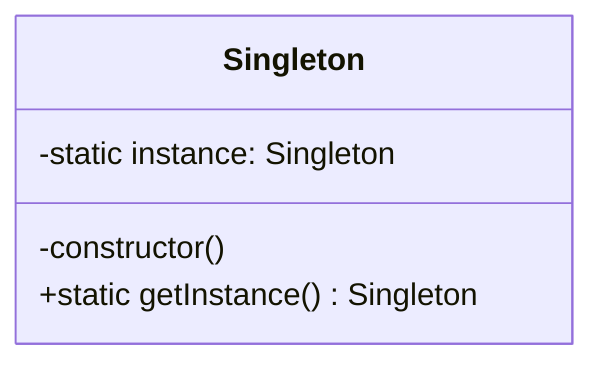

- **Singleton**：私有构造函数 + 静态 `getInstance()` + 静态私有实例字段——三个要素缺一不可

#### 四、核心实现

```typescript
class PrescriptionWsManager {
  private static instance: PrescriptionWsManager | null = null;
  private constructor() {}
  static getInstance(): PrescriptionWsManager {
    if (!PrescriptionWsManager.instance) {
      PrescriptionWsManager.instance = new PrescriptionWsManager();
    }
    return PrescriptionWsManager.instance;
  }
}
// ESM 版（更简洁）：直接导出实例，利用 module cache
export const wsManager = new PrescriptionWsManager();
```

- 笔记还收录了 ES5 闭包版、透明单例、单例与构造分离、封装变化（泛化单例工厂）等 5 种写法，按需挑选 2-3 种对比讲解

#### 五、易混淆辨析

- **ESM 模块 vs 单例模式**：ES Module 在运行时只被解析一次（Node.js `require` 缓存、浏览器 module graph），导出的对象默认引用唯一——但这是"无意图的单例"，与设计模式里"有意识封装唯一性"是两件事
- **懒汉式 vs 饿汉式**：懒汉式（首次调用才创建）vs 饿汉式（模块加载时立刻创建）——JS 单线程下无线程安全问题，但懒加载在浏览器中有性能意义
- **单例 vs 全局变量**：单例是"受控的唯一实例"，全局变量是"裸奔的共享状态"——单例多了构造私有、访问点统一两重保护

#### 六、前端工程落地

- Redux `createStore` 是单例（整个应用一个 store）
- axios 实例化一次全局复用（拦截器只配置一遍）
- Node.js `require` 缓存机制——CommonJS 模块天然单例的底层原理

#### 七、面试高频问

- ESM 模块和单例模式有什么区别？什么时候用 Class 单例而不是直接导出对象？
- 单例模式在单元测试中会有什么问题？怎么解决？
- Redux Store 是单例模式吗？它和普通单例有什么不同？

---

### 第 03 篇：工厂与建造者模式：创建哪种对象 vs 怎么组装对象

**副标题**：工厂负责"创建哪种对象"，建造者负责"按什么步骤组装复杂对象"

#### 一、场景切入

- 医疗系统对接多家物流商（顺丰/京东/极兔），每家 SDK 接口不同，但上层只关心"给我一个快递下单器"——工厂方法模式：把实例化逻辑集中到子类，调用方只调用 `createShipper()`
- 药品详情页需要组装一个复杂 `ReportConfig` 对象（数十个字段，部分可选），直接 `new ReportConfig(field1, field2, ..., field20)` 可读性极差——建造者模式：链式 `.setTitle().setDrugId().setShowWarning().build()` 清晰且防止漏传必填字段

#### 二、意图与本质

- **工厂模式**（简单工厂/工厂方法/抽象工厂）：把"实例化哪个类"的变化点从调用方抽离，调用方只面向抽象接口编程——解决的是"创建**哪种**对象"的变化
- **建造者模式**：把复杂对象的构建过程分解为多个步骤，构建与表示分离——解决的是"**怎么**创建复杂对象"的变化

#### 三、结构与角色

**工厂系**（三个递进层次，笔记一篇收全）：

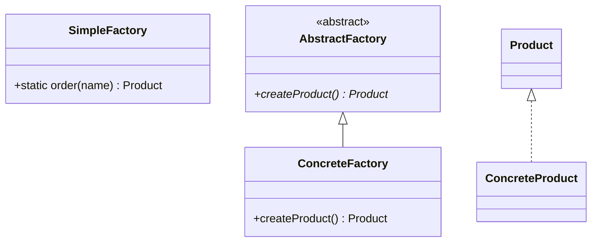

- **简单工厂**：一个工厂对象通过 switch/if 决定创建哪个产品——是函数，新增产品要改 switch，违反 OCP
- **工厂方法**：定义创建接口 `createProduct()`，子类决定实例化哪个类——新增产品只加子类，不改父类，遵守 OCP
- **抽象工厂**：生产一系列相关产品族（如 `MacUIFactory` 同时生产 `MacButton`/`MacInput`），与工厂方法区别在于产品族 vs 单一产品

**建造者**：

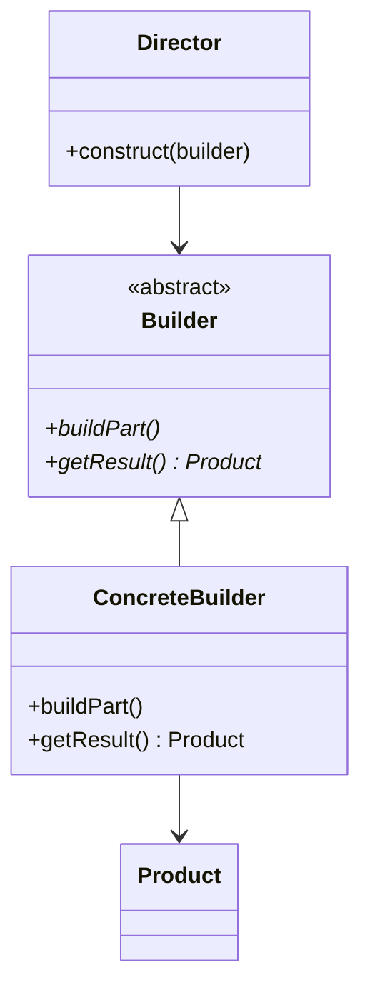

- 四个角色：**Product**（复杂对象）/ **Builder**（定义构建步骤）/ **ConcreteBuilder**（实现步骤）/ **Director**（控制构建顺序）
- TypeScript 中常用链式调用版本（流式建造者），省略 `Director`

#### 四、核心实现

```typescript
// 工厂方法：物流商工厂
abstract class ShipperFactory {
  abstract createShipper(): Shipper;
  ship(order: Order) { return this.createShipper().ship(order); }
}
// 建造者：药品报告配置
class ReportConfigBuilder {
  private config: Partial<ReportConfig> = {};
  setDrugId(id: string) { this.config.drugId = id; return this; }
  setShowWarning(show: boolean) { this.config.showWarning = show; return this; }
  build(): ReportConfig {
    if (!this.config.drugId) throw new Error('drugId required');
    return this.config as ReportConfig;
  }
}
```

#### 五、易混淆辨析

- **简单工厂 vs 工厂方法**：简单工厂是函数（违反 OCP），工厂方法把变化点封装进子类（遵守 OCP）——本质区别在"新增产品时改不改工厂代码"
- **工厂方法 vs 抽象工厂**：工厂方法针对"一个产品等级"，抽象工厂针对"多个产品族"——抽象工厂里包含多个工厂方法
- **建造者 vs 工厂**：工厂一次性返回完整对象（关心"创建哪种"），建造者分步骤组装（关心"怎么组装"）——参数超过 5 个且可选字段多时选建造者

#### 六、前端工程落地

- React `createElement` 是简单工厂（内部 switch 决定元素类型）
- React 早期 `createFactory(type)` 是工厂方法（`createElement.bind(null, type)`）
- jQuery `$()` 是简单工厂，`$.ajax(options)` 是建造者（options 对象分步骤装配）

#### 七、面试高频问

- 工厂方法和简单工厂有什么区别？各自违反或遵守了哪条设计原则？
- 建造者模式和工厂模式的区别是什么？什么场景下选建造者？
- 抽象工厂和工厂方法的关系是什么？

---

### 第 04 篇：原型模式：克隆创建对象，与 JS 原型链的本质区别

**副标题**：把这两件事搞清楚，一道高频辨析题就彻底解决了

#### 一、场景切入

- 医疗后台需要复制一张"处方模板"生成新处方——复制已有对象比重新配置一个新对象更高效，用原型模式 `clone()` 而不是 `new Prescription()`
- 大量相似配置对象（如多种药品规格 `DrugSpec`）的批量创建：以一个基准对象为原型，按需浅/深克隆修改少数字段

#### 二、意图与本质

- **意图**：通过复制（克隆）一个已有对象来创建新对象，而不是通过实例化类——当对象创建代价高（复杂初始化、大量配置）时更高效
- 解决的核心矛盾：对象"创建成本高"与"差异小"之间的张力——与其重新走一遍昂贵初始化，不如复制后微调

#### 三、结构与角色

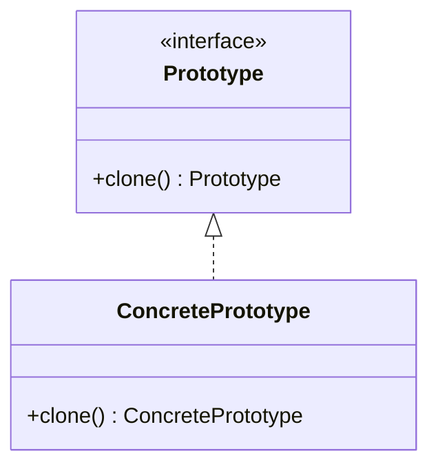

- **Prototype**：声明 `clone()` 接口；**ConcretePrototype**：实现克隆逻辑
- 原型注册表（`Map<string, Prototype>`）按名称存储和检索原型

#### 四、核心实现

```typescript
interface Cloneable<T> { clone(): T; }
class PrescriptionTemplate implements Cloneable<PrescriptionTemplate> {
  constructor(public drugId: string, public dosage: string, public warnings: string[]) {}
  clone(): PrescriptionTemplate {
    return new PrescriptionTemplate(this.drugId, this.dosage, [...this.warnings]);
  }
}
const registry = new Map<string, PrescriptionTemplate>();
```

#### 五、易混淆辨析

- **JavaScript 原型链 ≠ 原型模式**：原型链是 JS 的**继承机制**（对象通过 `[[Prototype]]` 共享方法），原型模式是一种**创建型设计模式**（克隆对象）。两者名字相同但完全不同概念——这是最高频的面试辨析点
- **浅克隆 vs 深克隆**：浅克隆（`Object.assign`/`{...obj}`）只复制一层，嵌套对象/数组仍共享引用；深克隆（`structuredClone`/`JSON.parse(JSON.stringify)`/lodash `cloneDeep`）递归复制——按需选择
- **原型 vs 工厂**：原型靠"复制"创建对象，工厂靠"实例化类"创建对象——对象初始化成本高、与原型差异小时选原型

#### 六、前端工程落地

- `Object.create()` 以指定原型创建对象，是原型模式的直接体现
- `structuredClone` 现代深克隆 API（注意函数/类实例无法克隆）
- 笔记中 Canvas 圆点动画的 `Circle` 复用即原型模式思路

#### 七、面试高频问

- JavaScript 的原型链和 GoF 原型模式是同一件事吗？分别解释。
- 浅克隆和深克隆的区别？`Object.assign` 是浅克隆还是深克隆，有什么坑？
- 什么场景下原型模式比工厂模式更合适？

---

### 第 05 篇：适配器与外观模式：包一层，改接口还是简调用

**副标题**：适配器解决"接口不兼容"，外观解决"接口太复杂"——都是包一层，但目的不同

#### 一、场景切入

- 医疗系统同时对接支付宝（返回 `{code, msg}`）和微信支付（返回 `{errcode, errmsg}`）SDK，上层业务代码不想关心两套字段命名——用适配器统一成 `{success, message}` 再往上传
- 初始化一次问诊页要调用 5 个子系统（用户认证、医生排班、IM 连接、订单、支付），业务组件不应逐个调用——用外观模式封装成一个 `initConsultation()` 方法

#### 二、意图与本质

- **适配器模式**：将一个接口转换成客户端期望的另一个接口，让不兼容的类可以协同工作——重点是"接口转换"，通常一对一包装
- **外观模式**：为子系统的一组接口提供一个统一的高层接口，简化复杂系统的使用——重点是"简化调用"，通常一对多聚合

#### 三、结构与角色

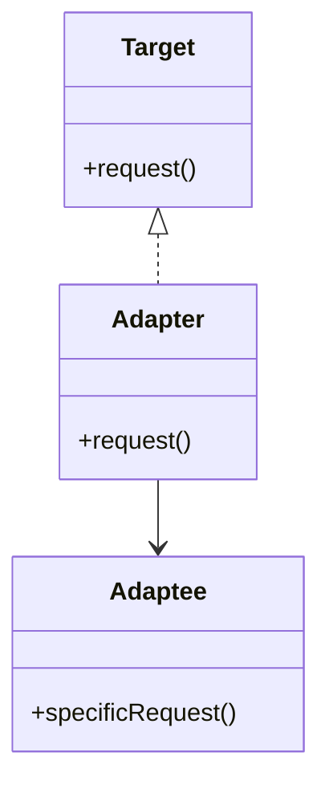

- 适配器三角色：**Target**（客户端期望接口）/ **Adapter**（转换器，持有 Adaptee）/ **Adaptee**（被适配的不兼容类）
- 类适配器（继承实现，JS 少用）vs 对象适配器（组合实现，JS 主流写法）
- 外观角色：**Facade**（门面，聚合子系统）/ **子系统角色**（被聚合的多个模块）/ **客户**（只认识 Facade）

#### 四、核心实现

```typescript
// 适配器：统一支付结果
interface PayResult { success: boolean; message: string; }
class AlipayAdapter implements PayResult {
  constructor(private raw: { code: number; msg: string }) {}
  get success() { return this.raw.code === 0; }
  get message() { return this.raw.msg; }
}
// 外观：问诊初始化聚合
class ConsultationFacade {
  async init(userId: string) {
    await authService.verify(userId);
    await scheduleService.checkDoctorAvailable();
    await imService.connect();
    return orderService.createDraft(userId);
  }
}
```

#### 五、易混淆辨析

- **适配器 vs 外观**：适配器改变的是**接口形态**（不改变复杂度），外观降低的是**使用复杂度**（不一定改变接口形态）——区分标准看"目的是兼容旧接口还是简化多调用"
- **外观 vs 中介者**（为第 16 篇埋点）：外观是单向简化调用（一对多），中介者是双向交互协调（多对多）

#### 六、前端工程落地

- axios 本身就是对 `XMLHttpRequest`/`fetch` 两种不同浏览器 API 的适配器，统一暴露 Promise 风格接口
- `promisify(fs.readFile)` 把 Node 回调风格适配为 Promise 风格
- 笔记中「jQuery `$.ajax` 适配到 axios」的 `toAxiosAdaptor` 也是典型适配器

#### 七、面试高频问

- 适配器模式和外观模式的核心区别是什么？
- axios 为什么算适配器模式的应用？
- 外观模式和中介者模式有什么相似和不同？

---

### 第 06 篇：装饰器模式：从 TS Decorator 到 React HOC 的增强术

**副标题**：不改源码给对象加能力，是 OCP 原则最直接的落地

#### 一、场景切入

- 给问诊订单加日志埋点、加权限校验、加数据脱敏，三个需求分别对应三个装饰器，可以自由组合叠加，而不是在原函数里堆 if-else
- React 高阶组件（HOC）`withAuth(Component)`、`withLoading(Component)` 本质是装饰器模式：不修改原组件，包一层增强行为
- TypeScript `@Decorator` 语法（NestJS `@Controller`/`@Injectable`）在编译期给类/方法附加元信息或包装行为

#### 二、意图与本质

- **意图**：动态地给对象添加额外职责，且比继承更灵活——继承是编译期静态扩展，装饰器是运行时动态组合
- 解决的核心矛盾：N 种基础功能 × M 种增强功能，继承需要 N×M 个子类（类爆炸），装饰器只需要 N+M 个类自由组合

#### 三、结构与角色

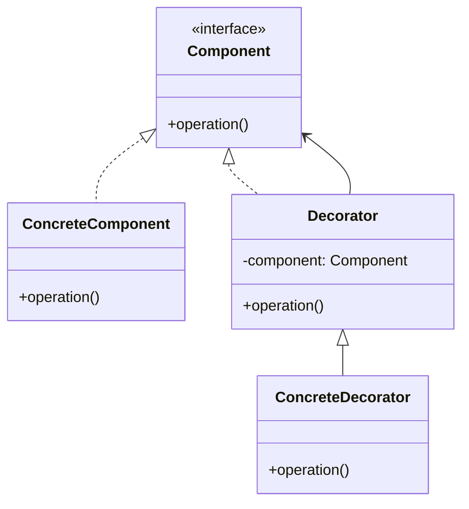

- **Component**（被装饰对象接口）/ **ConcreteComponent**（被装饰者）/ **Decorator**（持有 Component 引用，实现同一接口）/ **ConcreteDecorator**（具体增强）

#### 四、核心实现

```typescript
// 函数式装饰器：给请求函数加日志
function withLogging<T extends (...args: any[]) => any>(fn: T): T {
  return ((...args: any[]) => {
    console.log(`调用 ${fn.name}`, args);
    return fn(...args);
  }) as T;
}
// React HOC 装饰器
function withAuth<P extends object>(Component: React.ComponentType<P>) {
  return (props: P) => (isLoggedIn() ? <Component {...props} /> : <LoginPage />);
}
```

- 笔记还收录了类装饰器、装饰器工厂、属性/方法装饰器、AOP（before/after 钩子）、埋点（无痕埋点）等实现，按需取舍

#### 五、易混淆辨析

- **装饰器 vs 代理模式**（重点辨析，为第 07 篇埋点）：装饰器关注**增强职责**（加日志、加校验），代理关注**控制访问**（延迟加载、权限拦截）——意图不同，但实现结构几乎一样，因此常被面试官拿来互相追问
- **装饰器 vs 继承**：继承是编译期静态、类爆炸；装饰器是运行时动态、可组合——"组合优于继承"的体现

#### 六、前端工程落地

- React HOC `withAuth`/`withLoading` 是装饰器
- NestJS `@Controller`/`@Injectable` 是 TS Decorator 语法
- ES 提案 Decorator 语法糖本质是编译期生成的高阶函数包装

#### 七、面试高频问

- 装饰器模式和代理模式的区别是什么？（结构相似，意图不同）
- React HOC 属于什么设计模式？还有哪些方案能替代 HOC？
- 装饰器模式如何避免继承的类爆炸问题？

---

### 第 07 篇：代理模式：从 ES6 Proxy 到缓存、懒加载与权限拦截

**副标题**：Vue3 响应式的 Proxy 只是代理模式的一种应用，代理模式本身的分类远不止这一种

> 本篇讲代理模式的通用分类和跨框架场景，Proxy 的 `track/trigger` 具体源码实现见《Vue 3 源码》系列响应式篇，避免重复

#### 一、场景切入

- 处方图片首次访问才真正发起下载请求（虚拟代理/懒加载代理），而不是列表渲染时全部加载
- 药品价格接口调用频繁但结果短期不变，用代理模式在请求前拦截查缓存、缓存未命中才真正发请求（缓存代理）
- 医生只能查看自己患者的处方，护士只能查看但不能修改——用代理模式统一做权限拦截（保护代理），而不是在每个业务方法里判断权限

#### 二、意图与本质

- **意图**：为其他对象提供一种代理以控制对这个对象的访问——核心是"控制访问"，不改变原对象接口
- 解决的核心矛盾：在「访问对象」这件事上插入额外控制（延迟/缓存/鉴权），而不让调用方和对象本身感知

#### 三、结构与角色

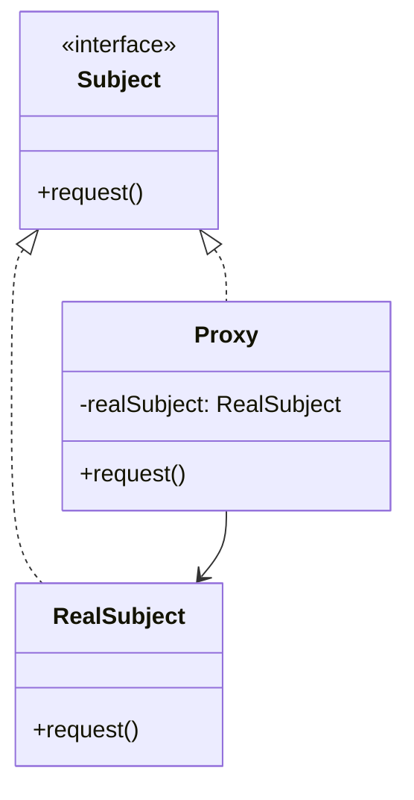

- **Subject**（公共接口）/ **RealSubject**（真实对象）/ **Proxy**（代理，持有 RealSubject 引用，实现同一接口）
- 代理的分类：**虚拟代理**（延迟创建开销大的对象）、**缓存代理**（拦截重复请求）、**保护代理**（权限控制）、**远程代理**（本地代理远程对象，如 RPC stub）

#### 四、核心实现

```typescript
// 缓存代理：拦截重复的药品价格查询
function createCacheProxy<T extends object>(target: T, ttl = 5000): T {
  const cache = new Map<string, { value: any; time: number }>();
  return new Proxy(target, {
    get(obj, prop: string) {
      const original = obj[prop as keyof T];
      if (typeof original !== 'function') return original;
      return (...args: any[]) => {
        const key = `${prop}:${JSON.stringify(args)}`;
        const hit = cache.get(key);
        if (hit && Date.now() - hit.time < ttl) return hit.value;
        const result = (original as Function).apply(obj, args);
        cache.set(key, { value: result, time: Date.now() });
        return result;
      };
    },
  });
}
```

- ES6 `Proxy` + `Reflect` 是语言层面提供的通用代理能力：13 种 trap（get/set/has/deleteProperty 等）可以拦截几乎所有对象操作

#### 五、易混淆辨析

- **代理 vs 装饰器**（承接第 06 篇）：代理通常在构造时就决定代理谁（且可能控制客户端拿不到真实对象），装饰器在运行时包装已有对象且不限制访问——**谁控制"是否放行"是分水岭**
- **代理 vs 适配器**：代理提供**一模一样的接口**（不换接口），适配器提供**不同的接口**（换接口）
- **设计模式代理 vs 网络「正向/反向代理」**：后者是网络架构术语（隐藏客户端/服务端信息），与 GoF 代理同名不同义，勿混
- **防抖/节流**：本质是函数包装（更接近装饰器），不属于代理模式

#### 六、前端工程落地

- Vue3 用 `Proxy` 做响应式（比 Vue2 `Object.defineProperty` 更彻底）
- 图片懒加载/预加载的虚拟代理（笔记有完整 `LoadingBackgroundImage` 示例）
- 事件委托（`ul` 上监听 `li` 点击）是代理思想的体现

#### 七、面试高频问

- 代理模式有哪几种常见分类？分别对应什么场景？
- 代理模式和装饰器模式结构相似，怎么从意图上区分？
- ES6 Proxy 相比 `Object.defineProperty` 有什么优势？

---

### 第 08 篇：组合与桥接模式：树形结构统一接口 vs 双维度解耦

**副标题**：组合模式让单个节点和整棵树的接口一致，桥接模式让两个独立变化的维度不互相绑定

#### 一、场景切入

- 医疗后台的科室-医生树：省级医院下有科室，科室下有医生，勾选"全院"等于勾选所有科室下所有医生——组合模式让"科室"和"医生"都响应 `getStaffCount()` 这同一个接口，遍历代码对两种节点一视同仁
- 药品销售报表支持"按地区"或"按药品类别"两个维度独立切换，且每个维度又有多种展示形式——如果用继承，需要 M×N 个子类（地区×报表类型）；桥接模式把两个维度分开，各自独立扩展

#### 二、意图与本质

- **组合模式**：将对象组合成树形结构，使单个对象（Leaf）和容器对象（Composite）都实现同一接口——核心是"统一接口"
- **桥接模式**：将抽象部分与实现部分分离，使它们可以独立变化——核心是"两个维度解耦"

#### 三、结构与角色

**组合**：

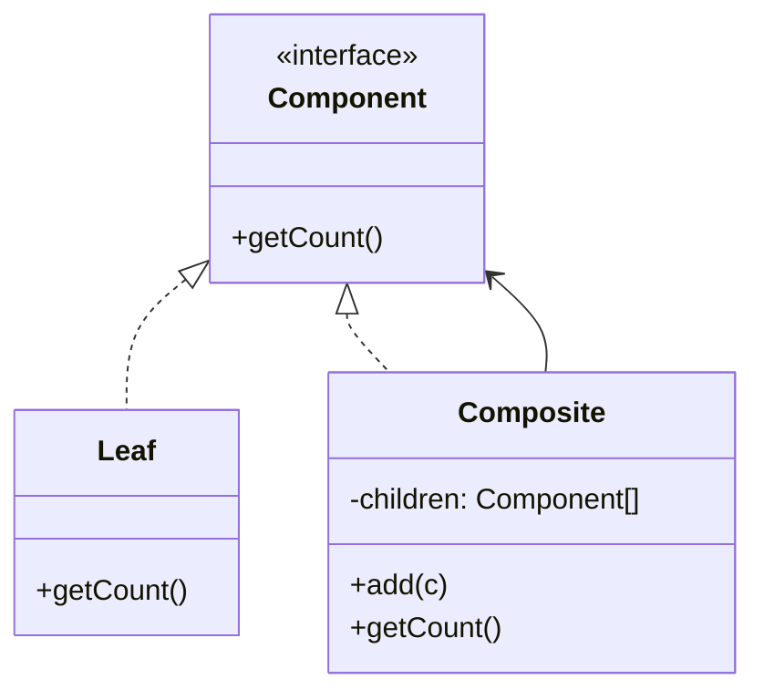

- **Component**（统一接口）/ **Leaf**（叶子，无子节点）/ **Composite**（容器，持有子节点列表）

**桥接**：

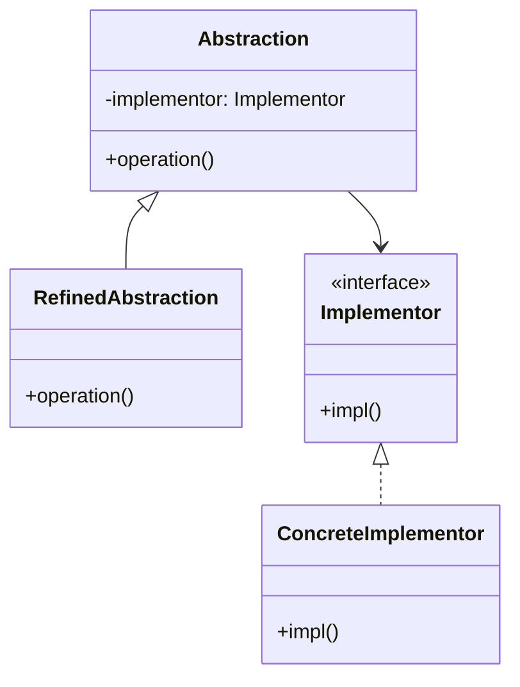

- **Abstraction**（抽象，持有 Implementor 引用）/ **Implementor**（实现接口）/ **ConcreteImplementor**（具体实现）——抽象与实现各自独立扩展

#### 四、核心实现

```typescript
// 组合模式：科室-医生树
interface StaffNode { getName(): string; getCount(): number; }
class Doctor implements StaffNode {
  constructor(private name: string) {}
  getName() { return this.name; }
  getCount() { return 1; }
}
class Department implements StaffNode {
  private children: StaffNode[] = [];
  constructor(private name: string) {}
  add(node: StaffNode) { this.children.push(node); }
  getName() { return this.name; }
  getCount() { return this.children.reduce((s, c) => s + c.getCount(), 0); }
}
```

#### 五、易混淆辨析

- **组合 vs 桥接**：组合是"树形递归"结构关注，桥接是"两个维度解耦"关注——组合问"怎么统一遍历"，桥接问"怎么独立扩展"
- **桥接 vs 策略**：桥接分离"抽象"与"实现"两个维度，策略在"同一维度"内替换算法——两者结构相似，桥接范围更广
- **组合 vs 装饰器**：组合是"整体与部分"的树形结构，装饰器是"层层包装"的链式结构——组合的 Composite 不改变叶子接口，装饰器会增强

#### 六、前端工程落地

- DOM 树（`element.children` 和 `element` 本身都能 `.querySelector`）、React 组件树（父组件和叶组件都渲染 JSX）——组合的天然案例
- 笔记中「文件夹/文件」树、「表单容器/表单项」绘制表单都是组合模式
- 笔记中「事件监听 getUserByIdBridge」（把回调从 DOM 操作中分离）体现桥接思想

#### 七、面试高频问

- 组合模式的核心思想是什么？举一个前端中的天然例子。
- 桥接模式解决了什么问题？它和策略模式有什么区别？
- 什么情况下继承会导致类爆炸？桥接模式怎么解决？

---

### 第 09 篇：享元模式：对象池与虚拟列表的节点复用术

**副标题**：共享不变部分，隔离可变部分——理解这句话，享元模式就通了

#### 一、场景切入

- 虚拟列表渲染 10 万条药品记录：只创建视口内可见数量（约 20 个）的 DOM 节点，滚动时复用节点、只更新数据——这是享元模式在前端最直接的工程案例
- Canvas 绘制大量医疗图表点位：每个数据点的"样式配置"共享同一个对象（享元），每个点的"坐标"各自存储（外部状态）

#### 二、意图与本质

- **意图**：用共享技术有效支持大量细粒度对象，将对象状态划分为内部状态（不变，可共享）和外部状态（可变，不共享），只共享内部状态
- 解决的核心矛盾：海量相似对象的内存压力——与其每份都存一份，不如共享「相同的部分」

#### 三、结构与角色

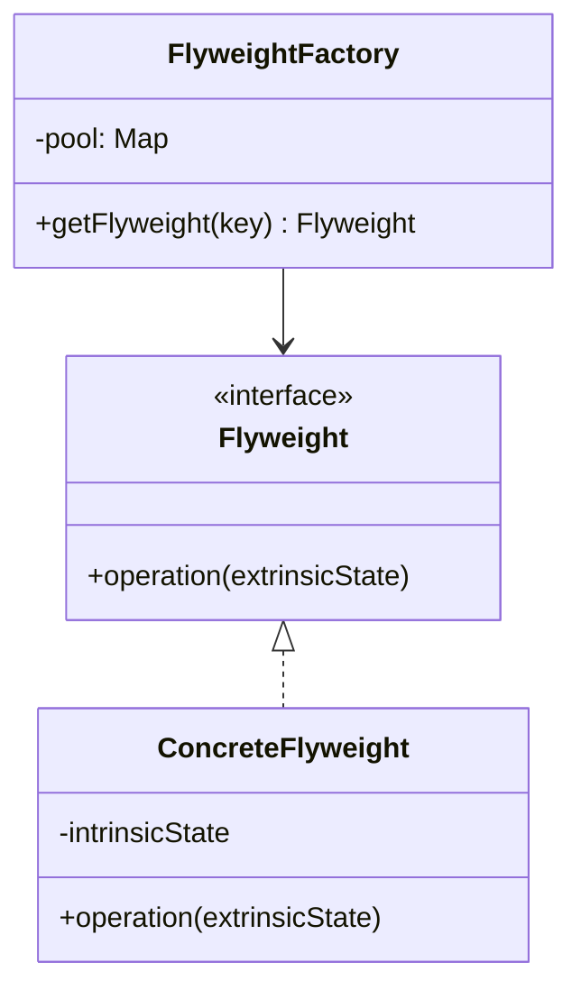

- **Flyweight**（享元接口）/ **ConcreteFlyweight**（持有内部状态）/ **FlyweightFactory**（享元工厂，管理对象池）
- **内部状态 vs 外部状态**：虚拟列表中，节点的 HTML 结构和样式是内部状态（共享），渲染的数据内容（第 N 条记录）是外部状态（每次渲染时传入）

#### 四、核心实现

```typescript
// 享元工厂：药品列表节点池（内部状态=DOM 结构样式）
class DrugListItemPool {
  private pool: HTMLElement[] = [];
  acquire(): HTMLElement {
    return this.pool.pop() ?? this.createItem();
  }
  release(el: HTMLElement) { this.pool.push(el); }
  private createItem() {
    const el = document.createElement('div');
    el.className = 'drug-list-item';
    return el;
  }
}
// 外部状态：渲染时注入
function renderItem(el: HTMLElement, drug: Drug) {
  el.dataset.id = drug.id;
  el.textContent = drug.name;
}
```

#### 五、易混淆辨析

- **共享方法 ≠ 享元**：JS 原型链把方法放在 `prototype` 上共享，是「共享方法」，不是享元——享元共享的是**对象实例的内部状态**（如 DOM 节点、样式配置对象）
- **享元 vs 缓存代理**：享元强调"对象数量减少"（共享对象本身），缓存代理强调"调用次数减少"（缓存调用结果）——两者常被混淆
- **享元 vs 对象池**：对象池是享元的一种实现手段，但对象池关注"复用实例避免重复创建销毁"，享元关注"共享内部状态减少内存"——侧重点不同

#### 六、前端工程落地

- 虚拟列表（react-window）节点复用：只创建视口内节点，滚动复用更新数据
- 字符串常量池（V8 内部）、React Fiber 节点池：运行时层面的享元优化，理解后能解释"为什么 key 很重要"
- 笔记中「分页 getLi 复用 DOM 节点」是最小可运行的享元示例

#### 七、面试高频问

- 享元模式的核心是什么？什么是内部状态和外部状态？
- 虚拟列表的节点复用是享元模式吗？和对象池有什么区别？
- 享元模式和缓存代理的区别是什么？

---

### 第 10 篇：观察者与发布订阅模式：有没有中介，是解耦的分水岭

**副标题**：全系列最高频也最容易答错的一道题，这一篇彻底讲清楚

> 本篇讲两种模式的通用抽象和跨框架场景（EventEmitter、DOM 自定义事件、Redux subscribe），Vue3 `track/trigger/effect` 的具体源码实现见《Vue 3 源码》系列响应式篇，避免重复

#### 一、场景切入

- 医生修改患者病历后，页面上的"病历摘要卡片"、"用药提醒"、"随访计划"三个互不相关的组件都要联动更新——如果让病历模块直接持有这三个组件的引用去逐个调用，耦合度极高
- 医患 IM 系统里，"新消息到达"这个事件需要被聊天窗口、未读计数、通知栏三个完全不知道彼此存在的模块响应——这正是发布订阅模式要解决的问题

#### 二、意图与本质

- **观察者模式**：定义一对多的依赖关系，一个 Subject 维护一个 Observer 列表，状态变化时**直接遍历调用**每个 Observer 的更新方法——Subject 知道 Observer 的存在（持有引用），是**双方耦合**（哪怕耦合度很低）
- **发布-订阅模式**：发布者和订阅者不直接认识，通过一个中介（Event Channel / Broker / EventBus）传递消息——是**完全解耦**，两者互不知道对方存在
- 两者共同解决的问题：解耦"状态变化"和"响应状态变化的逻辑"，让新增响应逻辑不需要修改状态产生方的代码（体现 OCP）

#### 三、结构与角色

**观察者**：

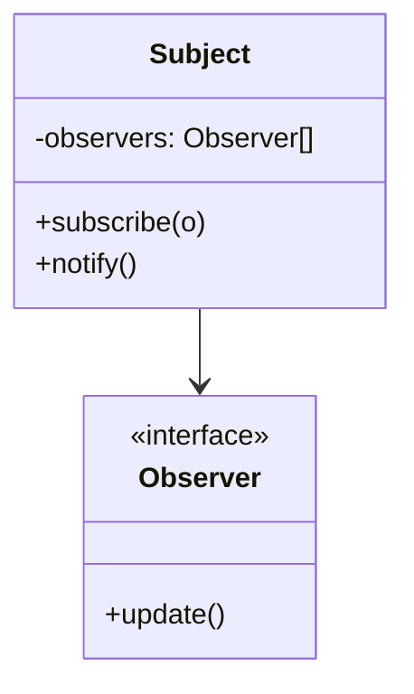

**发布订阅**（多一层中介）：

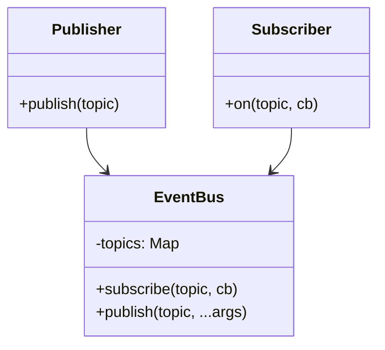

#### 四、核心实现

```typescript
// 观察者模式：Subject 直接持有 Observer
interface Observer { update(data: MedicalRecord): void; }
class MedicalRecordSubject {
  private observers: Observer[] = [];
  subscribe(o: Observer) { this.observers.push(o); }
  notify(data: MedicalRecord) { this.observers.forEach(o => o.update(data)); }
}
// 发布订阅模式：经过中介 EventBus 解耦
class EventBus {
  private events = new Map<string, Array<(...args: any[]) => void>>();
  on(event: string, cb: (...args: any[]) => void) {
    (this.events.get(event) ?? this.events.set(event, []).get(event)!).push(cb);
  }
  emit(event: string, ...args: any[]) {
    this.events.get(event)?.forEach(cb => cb(...args));
  }
}
```

#### 五、易混淆辨析

- **观察者 vs 发布订阅（面试必考）**：观察者模式是 Subject 与 Observer **直接关联**（Subject.notify() 里遍历 this.observers），发布订阅模式**多了一层中介**（Publisher 和 Subscriber 都只认识 EventBus，不认识对方）——**是否存在中介、是否互相知道对方**是核心区分点
- Vue2 的 `Dep`/`Watcher` 更贴近观察者模式（Dep 直接持有 Watcher 列表并 notify）；Node.js `EventEmitter`、浏览器自定义事件、消息队列更贴近发布订阅模式（都经过一个中心化的事件通道）

#### 六、前端工程落地

- DOM `addEventListener`、Redux `store.subscribe`、Node.js `EventEmitter.on` 表面都是"订阅-通知"，但底层结构不同
- 笔记中 jQuery `Callbacks`、Vue EventBus、`http.createServer().on('request')` 都是发布订阅
- 观察者模式如何避免内存泄漏：`subscribe` 返回 `unsubscribe` 函数，组件卸载时取消订阅

#### 七、面试高频问

- 观察者模式和发布订阅模式的本质区别是什么？（是否存在中介、是否互相知道对方）
- Vue 的响应式系统属于观察者模式还是发布订阅模式？
- Node.js 的 EventEmitter 算观察者模式吗？为什么？
- 观察者模式如何避免内存泄漏（忘记 unsubscribe）？

---

### 第 11 篇：策略模式：从表单校验到 Hook 封装的算法替换术

**副标题**：把"算法"封装成可互换的对象，让调用方不知道也不关心用的是哪一种

#### 一、场景切入

- 医疗平台的药品搜索排序：可以按"价格升序"、"销量降序"、"综合评分"、"距离"排序，每种排序逻辑都是一个策略，用户切换时直接替换策略对象，排序函数本身不变
- 处方表单校验：普通处方、精神类处方、麻醉处方有不同的校验规则，用策略模式把校验规则从表单逻辑里剥离，各规则独立可测

#### 二、意图与本质

- **意图**：定义一系列算法，将每一个封装起来，并使它们可以相互替换——调用方只面向策略接口编程，不依赖具体算法实现（DIP + OCP 的直接体现）
- 解决的核心矛盾："同一功能多种算法"与"切换/新增算法不能改调用方"之间的张力

#### 三、结构与角色

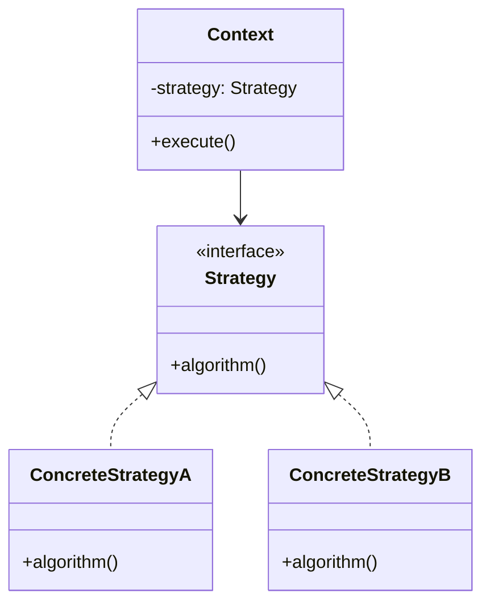

- **Strategy**（策略接口）/ **ConcreteStrategy**（具体算法）/ **Context**（上下文，持有策略，委托执行）
- JavaScript 一等函数下的简化：策略不需要封装成 class，直接用函数对象 `Map<string, (data: T) => R>` 作为策略注册表

#### 四、核心实现

```typescript
// 校验策略注册表（函数式版）
type ValidateStrategy = (value: string) => string | null;
const prescriptionValidators: Record<string, ValidateStrategy> = {
  normal: (v) => v.trim() ? null : '不能为空',
  controlled: (v) => /^[A-Z]{2}\d{6}$/.test(v) ? null : '格式不符合管制药品规范',
  anesthetic: (v) => v.length >= 20 ? null : '麻醉药品处方编号不足20位',
};
function validate(type: string, value: string) {
  return prescriptionValidators[type]?.(value) ?? null;
}
```

#### 五、易混淆辨析

- **策略 vs if-else**：`if (type === 'price') sort by price; else if ...` 每新增一种排序就要改函数内部——违反 OCP；策略模式新增排序只加一个策略类，调用方零改动
- **策略 vs 状态模式**（辨析，为第 14 篇埋点）：策略模式的"策略"是由外部传入的（调用方决定用哪个），状态模式的"状态"是内部自主迁移的（对象自己管理自己用哪个）——**谁决定切换**是核心区分点

#### 六、前端工程落地

- 笔记中 jQuery `animate` 的 easing（swing/linear）是策略模式
- Zod / yup 等校验库的 schema 设计（策略模式的实际应用）
- 表单校验规则剥离（普通/管制/麻醉三种处方各自独立可测）

#### 七、面试高频问

- 策略模式和状态模式的区别是什么？（策略由外部注入，状态由内部迁移）
- 用 if-else 实现多种算法和用策略模式实现有什么本质区别？
- JavaScript 里不用 class 怎么实现策略模式？

---

### 第 12 篇：职责链模式：中间件、拦截器与事件冒泡的本质

**副标题**：Express/Koa 中间件、axios 拦截器、事件冒泡——全是职责链，只是形态不同

> 本篇讲职责链作为设计模式的通用形态，Koa `compose` 的具体源码手写实现见《Node.js 全栈》系列，避免重复

#### 一、场景切入

- 处方提交前需要依次通过：参数校验 → 用药禁忌检查 → 库存校验 → 风控审核，任意一环失败就中断，通过才真正提交——用职责链把每个检查解耦成独立 Handler，顺序调用，随时可以插拔新检查项
- Express/Koa 的 `app.use(middleware)` 就是注册一个 Handler 进链；`next()` 就是把控制权传递给下一个

#### 二、意图与本质

- **意图**：将请求的发送方和处理方解耦——沿着一条链传递请求，链上的 Handler 依次判断"我能不能处理"，能则处理，不能则传递给下一个
- 解决的核心矛盾：一段「多步骤、可插拔、顺序可变」的处理流程，不想写死在单个函数里

#### 三、结构与角色

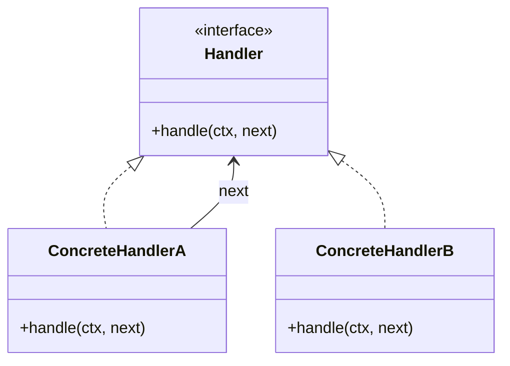

- **Handler**（处理器接口）/ **ConcreteHandler**（具体处理器，持有下一个 Handler 引用或通过 next 传递）
- 纯职责链（每个 Handler 只处理或只传递，不能两者都做）vs 变体（每个 Handler 都可处理且可选择是否继续传递，即中间件模式）

#### 四、核心实现

```typescript
// 处方校验职责链（中间件变体）
type Handler = (ctx: PrescriptionCtx, next: () => Promise<void>) => Promise<void>;
function compose(handlers: Handler[]) {
  return (ctx: PrescriptionCtx) => {
    let i = 0;
    const next = () => handlers[i] ? handlers[i++](ctx, next) : Promise.resolve();
    return next();
  };
}
const pipeline = compose([
  validateParams,
  checkContraindications,
  checkInventory,
  riskAudit,
]);
```

#### 五、易混淆辨析

- **职责链 vs 中间件**：中间件是职责链的变体——每个节点既可处理又可选择是否继续传递（洋葱模型），纯职责链是单向传递（只能处理或传递其一）
- **洋葱模型**：Koa 中间件在 `next()` 前后都有代码，形成"进入-穿越-返回"的嵌套执行顺序，与简单职责链的单向传递不同
- **职责链 vs 策略**：策略模式选一个执行，职责链全部依次通过（或某个中断）

#### 六、前端工程落地

- Koa `koa-compose`（约 50 行，是学习职责链变体的最佳范本）
- Express 中间件机制、axios 请求/响应拦截器（按注册顺序依次执行）
- 事件冒泡/捕获：从内到外逐层传递，是职责链的 DOM 原生体现

#### 七、面试高频问

- 职责链模式和中间件模式有什么关系？它们是同一种模式吗？
- Koa 的洋葱模型和普通职责链有什么区别？
- 职责链、策略、命令模式都能解耦请求处理，区别在哪？

---

### 第 13 篇：命令模式：撤销重做、任务队列与 Redux Action

**副标题**：把"请求"本身封装成对象，就能存储、排队、回放、撤销它

#### 一、场景切入

- 医疗后台的病历编辑器需要支持 Ctrl+Z 撤销/Ctrl+Y 重做：每次编辑操作封装成一个 Command 对象，undo 栈存储历史，撤销时弹出并调用 `undo()`
- 批量操作队列：药品库存盘点时，审核员确认后一次性提交 50 条修改，失败可整体回滚——每条修改是一个命令对象，队列统一执行

#### 二、意图与本质

- **意图**：将一个请求封装成对象，从而可以用不同的请求参数化客户端、对请求排队、记录请求日志、支持可撤销操作
- 解决的核心矛盾：把「动作」从「执行者」中抽离出来变成一等公民，让动作可以被存储、排队、撤销

#### 三、结构与角色

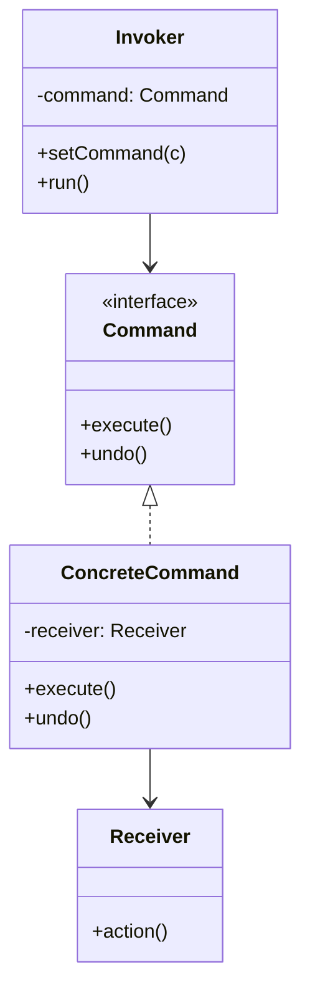

- **Command**（封装请求的接口，有 `execute()`/`undo()`）/ **ConcreteCommand**（具体命令，持有接收者引用）/ **Invoker**（调用者，只认识 Command 接口）/ **Receiver**（真正执行操作的对象）

#### 四、核心实现

```typescript
interface Command { execute(): void; undo(): void; }
class EditRecordCommand implements Command {
  private backup: string;
  constructor(private record: MedicalRecord, private newContent: string) {
    this.backup = record.content;
  }
  execute() { this.record.content = this.newContent; }
  undo() { this.record.content = this.backup; }
}
class CommandHistory {
  private stack: Command[] = [];
  execute(cmd: Command) { cmd.execute(); this.stack.push(cmd); }
  undo() { this.stack.pop()?.undo(); }
}
```

- 撤销实现的两种策略：①保存操作前快照（备忘录，简单但内存大）；②保存逆操作（`undo()` 里写反向逻辑，节省内存但需要实现逆操作）
- 宏命令（MacroCommand）：组合多个命令为一个命令，`execute()` 里依次执行子命令——是组合模式在命令上的应用

#### 五、易混淆辨析

- **命令 vs 策略**：命令封装的是"请求"（可撤销、可排队），策略封装的是"算法"（可互换执行）——命令多了 undo/队列/日志的维度

#### 六、前端工程落地

- Redux action 本质是命令模式：`dispatch({ type: 'ADD_TO_CART', payload: drug })` 是一个命令对象，reducer 是命令执行器，action history 是命令队列
- Immer.js（基于快照实现 undo 的典型工具）
- 笔记中计数器/撤销重做/多步撤销重做三段递进示例，是理解命令模式的最佳路径

#### 七、面试高频问

- 命令模式和策略模式的区别是什么？（命令封装的是"请求"可撤销，策略封装的是"算法"可替换）
- Redux 的 action/reducer 架构体现了哪种设计模式？
- 撤销操作的两种实现方式各有什么优缺点？

---

### 第 14 篇：状态与模板方法模式：用结构取代 if-else 与流程复用

**副标题**：状态模式管理"状态怎么迁移"，模板方法固定"骨架不能改、细节可以改"

#### 一、场景切入

- 处方订单有"待审核 → 已通过 → 已发药 → 已完成"或"待审核 → 已拒绝"等状态流转，每个状态下允许的操作和下一步跳转都不同——用一堆 `if (status === 'pending')` 判断会随状态增多迅速失控，用状态模式把每个状态封装成对象，各自管理自己能做什么、能跳到哪
- 三种问诊类型（图文/电话/视频）的接诊流程骨架完全一致（建档 → 候诊 → 接诊 → 开处方 → 结束），只有"接诊"这一步的具体实现不同——用模板方法固定骨架，子类只重写差异步骤

#### 二、意图与本质

- **状态模式**：允许对象在内部状态改变时改变它的行为，看起来就像改变了类——状态迁移逻辑分散在各状态类中，而非集中在一个大 switch 里
- **模板方法模式**：在父类中定义一个算法的骨架（`template()` 方法固定步骤顺序），将某些步骤延迟到子类实现——是"继承"用于复用流程骨架的经典场景

#### 三、结构与角色

**状态**：

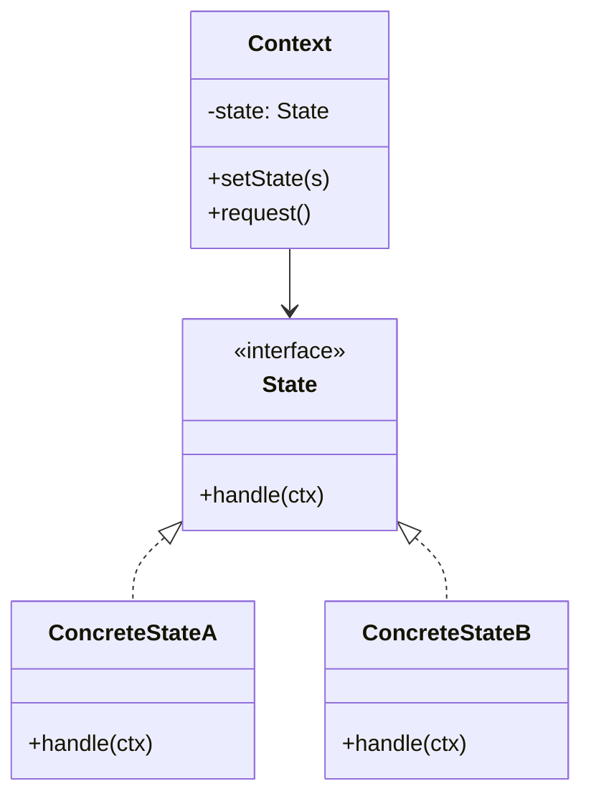

**模板方法**：

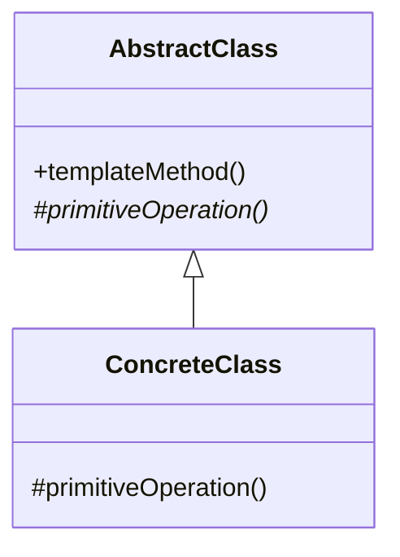

#### 四、核心实现

```typescript
// 状态模式：处方订单状态
interface OrderState {
  approve(order: PrescriptionOrder): void;
  reject(order: PrescriptionOrder): void;
}
class PendingState implements OrderState {
  approve(order: PrescriptionOrder) { order.setState(new ApprovedState()); }
  reject(order: PrescriptionOrder) { order.setState(new RejectedState()); }
}
// 模板方法：三种问诊流程骨架
abstract class ConsultationFlow {
  run() { // 模板方法：骨架固定，不可被子类改变调用顺序
    this.createRecord();
    this.waitInQueue();
    this.consult(); // 唯一可变步骤
    this.issuePrescription();
  }
  protected abstract consult(): void;
  private createRecord() { /* 固定实现 */ }
  private waitInQueue() { /* 固定实现 */ }
  private issuePrescription() { /* 固定实现 */ }
}
```

#### 五、易混淆辨析

- **状态 vs 策略**（承接第 11 篇）：策略由外部调用方选择使用哪个，状态由对象自身根据当前状态决定行为并自主迁移到下个状态——**谁决定切换、是否自主迁移**是核心区分点
- **状态 vs 有限状态机（FSM）**：状态模式是 FSM 的一种面向对象实现方式，FSM 是更抽象的数学模型（状态+事件+迁移表），XState 等状态机库把迁移表显式配置化，比手写状态模式类更易维护和可视化
- **模板方法 vs 策略**：模板方法用继承固定骨架（编译期），策略用组合替换算法（运行期）——模板方法重"流程复用"，策略重"算法替换"

#### 六、前端工程落地

- 笔记中电池状态（Success/Warning/Error 三种状态自迁移）、点赞按钮（liked/like 状态切换）是状态模式
- 笔记中 Modal 提示框（ConfirmModal/InfoModal 复用骨架）是模板方法
- XState（状态机可视化配置）是状态模式的工程化升级

#### 七、面试高频问

- 状态模式和策略模式的区别是什么？（谁决定切换、是否自主迁移）
- 状态模式和有限状态机是什么关系？
- 模板方法模式如何体现"好莱坞原则"（父类调用子类，而非子类调用父类）？

---

### 第 15 篇：迭代器模式：Iterator 协议、Generator 与惰性遍历

**副标题**：JavaScript 的 `for...of`、展开运算符、解构赋值背后都是同一个迭代器协议

#### 一、场景切入

- 药品列表支持多种遍历方式：按字母顺序、按价格、按科室分组——迭代器模式把遍历逻辑从集合里剥离，不同遍历策略换一个迭代器即可，不改集合类本身
- 分页数据的懒加载遍历：用迭代器封装"当前页用完了就自动请求下一页"的逻辑，调用方只管 `for...of`，不关心何时发请求

#### 二、意图与本质

- **意图**：提供一种方法顺序访问一个聚合对象中的各个元素，而不暴露该对象的内部表示——调用方不需要知道集合是数组、链表还是树
- 解决的核心矛盾："遍历方式多变"与"集合结构稳定"之间的张力——遍历逻辑不该绑死在集合上

#### 三、结构与角色

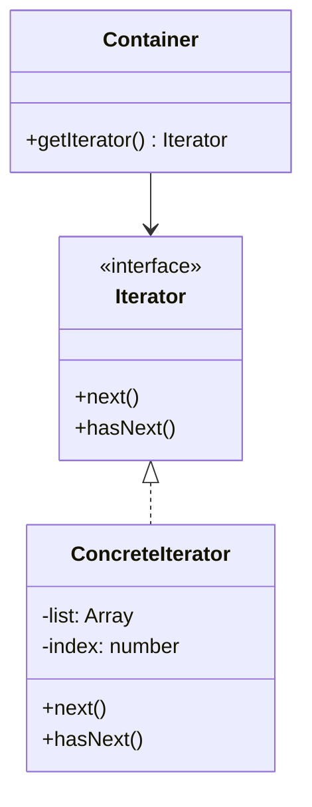

- **Iterator**（迭代器接口）/ **ConcreteIterator**（具体迭代器，持有游标）/ **Container**（聚合对象，提供 `getIterator()`）

#### 四、核心实现

```typescript
// 自定义可迭代集合：分页药品列表
class PaginatedDrugList implements Iterable<Drug> {
  constructor(private pages: Drug[][]) {}
  [Symbol.iterator](): Iterator<Drug> {
    let pageIdx = 0, itemIdx = 0;
    const pages = this.pages;
    return {
      next() {
        if (pageIdx >= pages.length) return { value: undefined as any, done: true };
        const value = pages[pageIdx][itemIdx++];
        if (itemIdx >= pages[pageIdx].length) { pageIdx++; itemIdx = 0; }
        return { value, done: false };
      }
    };
  }
}
// Generator 版：惰性无限序列
function* drugIdGenerator(prefix: string) {
  let i = 1;
  while (true) yield `${prefix}-${String(i++).padStart(6, '0')}`;
}
```

#### 五、易混淆辨析

- **JavaScript 迭代器协议**：实现了 `[Symbol.iterator]()` 方法且返回有 `next(): { value, done }` 的对象，就是可迭代对象——语言层面的迭代器模式标准化
- **Generator vs 迭代器**：Generator（`function*`）是实现迭代器的语法糖——`yield` 暂停并返回值，调用方 `next()` 继续执行，天然实现惰性求值
- **迭代器 vs `forEach`**：`forEach` 无法中途 `break`（除非 `throw`），迭代器可以随时停止迭代；迭代器也支持异步（`async function*` + `for await...of`）

#### 六、前端工程落地

- `for...of`、展开运算符 `[...arr]`、解构赋值、`Array.from()`、`Map`/`Set`/字符串/`arguments` 全部基于同一个协议
- 笔记中「Generator 遍历二叉树（先中后序）」是迭代器与树结构的经典结合
- jQuery `$.each`、手写 `forEach` 是迭代器的函数式变体

#### 七、面试高频问

- JavaScript 的迭代器协议是什么？哪些内置类型实现了它？
- Generator 和普通迭代器有什么关系？Generator 的惰性求值体现在哪里？
- `for...of` 和 `forEach` 的本质区别是什么？

---

### 第 16 篇：中介者、备忘录、访问者与解释器模式：低频四模式的典型场景速通

**副标题**：前端出现频率最低的四个模式，各用一个典型场景讲透，不为凑篇数注水

> 本篇采用简版骨架，每个模式只讲「意图 + 结构 + 一个典型场景 + 一句辨析」，聚焦高频考点，不做过度展开。

#### 一、中介者模式

- **意图**：用一个中介对象封装一系列对象的交互，使对象不需要显式地相互引用，从而降低耦合
- **结构**：Mediator（中介接口）/ ConcreteMediator（具体中介，协调各 Colleague）/ Colleague（同事对象，只认识中介）
- **典型场景**：多个表单字段互相联动校验（选了"处方药"则"用药说明"必填，选了"进口药"则"海关备案号"必填），字段之间不直接引用对方，而是都通过一个 `FormMediator` 协调
- **一句辨析**：中介者 vs 外观——中介者关注**多个对象之间的双向交互协调**，外观关注**单向简化调用**（承接第 05 篇）

#### 二、备忘录模式

- **意图**：在不破坏封装性的前提下，捕获并外部化一个对象的内部状态，以便之后恢复
- **结构**：Originator（发起人，产生快照）/ Memento（备忘录，存状态）/ Caretaker（管理者，存/取备忘录）
- **典型场景**：病历编辑器的"保存历史快照"能力，与命令模式的 undo 栈配合——备忘录负责"存什么、怎么存"，命令模式负责"什么时候存、什么时候恢复"
- **一句辨析**：备忘录 vs 命令的 undo——命令的 undo 可以"存逆操作"（省内存但需实现逆操作），也可以"用备忘录存快照"（简单但内存大），两者常配合

#### 三、访问者模式

- **意图**：将作用于某种数据结构的操作从数据结构中分离出来，封装成独立的 Visitor 类
- **结构**：Visitor（访问者接口，为每种节点声明 visit 方法）/ ConcreteVisitor（具体操作）/ Element（元素，提供 `accept(visitor)`）
- **典型场景**：对一棵 AST（如富文本编辑器的文档树）做多种不同处理——导出为 HTML、导出为纯文本、统计字数——不修改节点类本身，而是把每种处理抽成一个 Visitor
- **一句辨析**：访问者的精髓是**双分发（double dispatch）**——`element.accept(visitor)` 里 `visitor.visit(this)`，让"数据结构类型"和"操作类型"两个维度独立扩展；Babel 插件、ESLint 规则本质都是访问者模式

#### 四、解释器模式

- **意图**：给定一个语言，定义它的语法表示，并定义一个解释器来解释该语言中的句子
- **结构**：Context（上下文）/ AbstractExpression（抽象表达式）/ TerminalExpression（终结符）/ NonTerminalExpression（非终结符）
- **典型场景**：药品定价规则引擎（"满 200 减 20，会员再打 9 折"）用简单的自定义 DSL 描述规则，解释器负责解析和执行这个 DSL
- **一句辨析**：工业级场景通常不手写解释器而用现成解析库——面试掌握「意图 + 何时出现」即可，不必背完整实现

**面试核心问**：
- 中介者模式和外观模式有什么区别？（多向协调 vs 单向简化）
- 备忘录模式和命令模式的 undo 实现有什么关系？
- 访问者模式如何在不修改数据结构类的前提下新增操作？体现了什么原则？
- 你有没有在项目中见过解释器模式的应用（如规则引擎、模板引擎）？

---

## 面试高频专题

以下是本系列反复强调、容易混淆的辨析对比，建议整理成单独的速查笔记：

| 辨析对比 | 核心区别 | 对应篇章 |
|---------|---------|---------|
| JS 原型链 vs 原型模式 | 前者是继承机制，后者是克隆创建对象的设计模式，名字相同但完全不同概念 | 第 04 篇 |
| 简单工厂 vs 工厂方法 | 简单工厂是函数（违反 OCP），工厂方法把变化点封装进子类（遵守 OCP） | 第 03 篇 |
| 工厂方法 vs 抽象工厂 | 工厂方法针对单一产品等级，抽象工厂针对多个产品族 | 第 03 篇 |
| 适配器模式 vs 外观模式 | 适配器改变接口形态（一对一），外观简化调用复杂度（一对多） | 第 05 篇 |
| 装饰器模式 vs 代理模式 | 装饰器强调动态增强职责，代理强调控制访问，结构相似意图不同 | 第 06/07 篇 |
| 代理模式 vs 适配器模式 | 代理提供一模一样接口，适配器提供不同接口 | 第 07 篇 |
| 组合模式 vs 桥接模式 | 组合关注树形递归结构，桥接关注两个维度解耦 | 第 08 篇 |
| 桥接模式 vs 策略模式 | 桥接分离抽象与实现两维度，策略在同一维度内替换算法 | 第 08 篇 |
| 享元模式 vs 缓存代理 | 享元减少对象数量（共享对象本身），缓存代理减少调用次数（缓存结果） | 第 09 篇 |
| 共享方法 vs 享元 | 原型链共享的是方法，享元共享的是对象实例的内部状态 | 第 09 篇 |
| 观察者模式 vs 发布订阅模式 | 观察者 Subject 直接持有 Observer 列表（双方耦合），发布订阅经过中介 EventBus（完全解耦） | 第 10 篇 |
| 策略模式 vs 状态模式 | 策略由外部调用方选择使用哪个，状态由对象自身根据当前状态自主决定并迁移 | 第 11/14 篇 |
| 职责链模式 vs 中间件模式 | 中间件是职责链的变体：每个节点既可处理又可选择继续传递（洋葱模型），纯职责链是单向传递 | 第 12 篇 |
| 命令模式 vs 策略模式 | 命令封装"请求"（可撤销、可排队），策略封装"算法"（可互换执行） | 第 13 篇 |
| 状态模式 vs 有限状态机 | 状态模式是 FSM 的一种面向对象实现方式，FSM 是更抽象的数学模型 | 第 14 篇 |
| 模板方法 vs 策略模式 | 模板方法用继承固定骨架（编译期），策略用组合替换算法（运行期） | 第 14 篇 |
| 中介者模式 vs 外观模式 | 中介者协调多个对象的双向交互，外观简化对一组子系统的单向调用 | 第 05/16 篇 |
| 备忘录 vs 命令 undo | 备忘录存快照（省逆操作），命令 undo 存逆操作（省内存），常配合 | 第 16 篇 |

---

## 各篇标准笔记模板

每篇文章发布前，先在 `docs/notes/11 design/` 对应分类目录建立或更新笔记，笔记结构与文章七步骨架一致：

```markdown
# {模式名称}

## 意图
一句话描述这个模式解决的问题 + 解决的核心矛盾

## 结构（类图 + 角色）
- mermaid 类图
- 参与角色清单

## 核心实现
TypeScript 代码（统一医疗/药品/处方命名）

## 易混淆辨析
（如与本模式结构相似、意图不同的模式对比）

## 前端工程落地
（React/Vue/axios/Redux/Koa 真实场景）

## 面试问答记录
- Q:
  A:
```

命名沿用现有约定：`docs/notes/11 design/03 创建型模式/01 工厂模式.md`、`docs/notes/11 design/05 行为模式/12 职责链模式.md` 等。

> 笔记文件名带 `_` 后缀（如 `02 建造者模式_.md`）表示该篇笔记为初稿、内容待补全，写对应文章前需先完善笔记。

---

## 参考资源池

- 《设计模式：可复用面向对象软件的基础》（GoF 原著，23 种模式的权威出处）
- 《Head First 设计模式》（案例更贴近实战，适合入门后查漏补缺）
- 《JavaScript 设计模式与开发实践》曾探 著（前端场景化讲解，中文资料首选）
- refactoring.guru 设计模式图解站（每种模式配 UML 图 + 多语言代码示例）
- MDN Proxy / Iterator / Generator 官方文档
- Vue 3、Redux、Koa、axios 源码（本系列多处引用，均为已在项目中实际使用的技术栈）

---

*规划时间：2026-09-11（2026-10-12 重构为七步骨架） | 目标读者：5-10 年前端/全栈，系统备战大厂设计模式面试*
