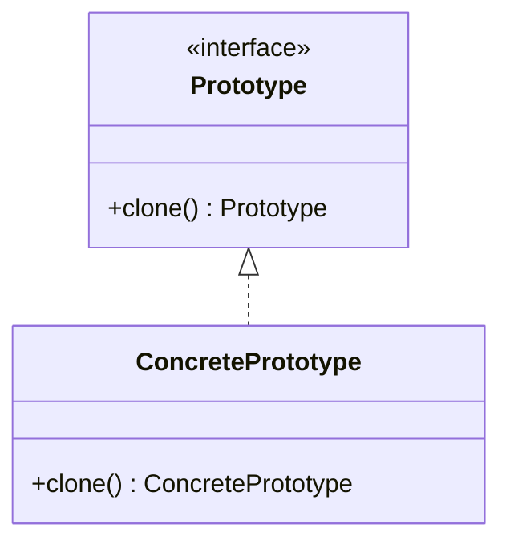

# prompt

```text
/publish 下面我们规划前端设计模式系列的第6篇文章，具体如下：
{{
## 知识点范围

### 第 04 篇：原型模式：克隆创建对象，与 JS 原型链的本质区别

**副标题**：把这两件事搞清楚，一道高频辨析题就彻底解决了

#### 一、场景切入

- 医疗后台需要复制一张"处方模板"生成新处方——复制已有对象比重新配置一个新对象更高效，用原型模式 `clone()` 而不是 `new Prescription()`
- 大量相似配置对象（如多种药品规格 `DrugSpec`）的批量创建：以一个基准对象为原型，按需浅/深克隆修改少数字段

#### 二、意图与本质

- **意图**：通过复制（克隆）一个已有对象来创建新对象，而不是通过实例化类——当对象创建代价高（复杂初始化、大量配置）时更高效
- 解决的核心矛盾：对象"创建成本高"与"差异小"之间的张力——与其重新走一遍昂贵初始化，不如复制后微调

#### 三、结构与角色



- **Prototype**：声明 `clone()` 接口；**ConcretePrototype**：实现克隆逻辑
- 原型注册表（`Map<string, Prototype>`）按名称存储和检索原型

#### 四、核心实现

```typescript
interface Cloneable<T> { clone(): T; }
class PrescriptionTemplate implements Cloneable<PrescriptionTemplate> {
  constructor(public drugId: string, public dosage: string, public warnings: string[]) {}
  clone(): PrescriptionTemplate {
    return new PrescriptionTemplate(this.drugId, this.dosage, [...this.warnings]);
  }
}
const registry = new Map<string, PrescriptionTemplate>();
```

#### 五、易混淆辨析

- **JavaScript 原型链 ≠ 原型模式**：原型链是 JS 的**继承机制**（对象通过 `[[Prototype]]` 共享方法），原型模式是一种**创建型设计模式**（克隆对象）。两者名字相同但完全不同概念——这是最高频的面试辨析点
- **浅克隆 vs 深克隆**：浅克隆（`Object.assign`/`{...obj}`）只复制一层，嵌套对象/数组仍共享引用；深克隆（`structuredClone`/`JSON.parse(JSON.stringify)`/lodash `cloneDeep`）递归复制——按需选择
- **原型 vs 工厂**：原型靠"复制"创建对象，工厂靠"实例化类"创建对象——对象初始化成本高、与原型差异小时选原型

#### 六、前端工程落地

- `Object.create()` 以指定原型创建对象，是原型模式的直接体现
- `structuredClone` 现代深克隆 API（注意函数/类实例无法克隆）
- 笔记中 Canvas 圆点动画的 `Circle` 复用即原型模式思路

#### 七、面试高频问

- JavaScript 的原型链和 GoF 原型模式是同一件事吗？分别解释。
- 浅克隆和深克隆的区别？`Object.assign` 是浅克隆还是深克隆，有什么坑？
- 什么场景下原型模式比工厂模式更合适？


## 已有笔记

- @docs\notes\11 design\03 创建型模式\03 原型模式.md

## plans 地址

- @docs\plans\08 design-patterns-series-outline.md

## 规则

- 笔记只关注 @docs\notes\11 design 目录下的，其他目录禁止自行读取
- 补全内容（保留原有内容，只增不删），保留图片，一些知识点的说明图片可以从网络上获取，尽量使用图片加以说明，这样跟容易学习和理解
- 将整理后的内容生成公众号文章，输出到 @docs\articles\11 design
- 文章结构：先出大纲等我确认，再逐节写作
}}
，注意⚠️：
- 本系列 适用于 5-10年的开发者，想要系统性的学习，并且想要完全掌握 设计模式 相关 的开发者。
- 保留笔记完整代码和图片，样式格式保持一致和这篇@docs\articles\11 design\2026-10-28-uml-and-design-patterns-overview.md，不读我没要求到的文件；
- 可以根据你的经验和最佳实践查漏补缺；主线要明确清晰；每个知识点都要由浅入深的彻底讲透，讲明白。
```


