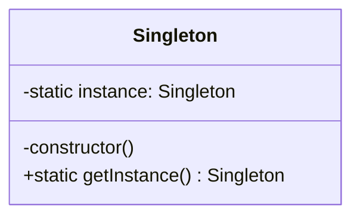

# prompt

```text
/publish 下面我们规划前端设计模式系列的第3篇文章，具体如下：
{{
## 知识点范围

### 第 03 篇：单例模式：从 ESM 模块缓存到全局状态管理

**副标题**：ESM 模块天然是单例，但"天然"不等于"有设计意图"

#### 一、场景切入

- 医疗系统里全局唯一的消息提示（Toast）、权限配置（PermissionConfig）、WebSocket 连接管理器——每次 `new` 都会产生副作用，必须保证唯一实例
- Redux Store 是前端最典型单例：整个应用共享同一个 state 树，`createStore` 只调用一次
- axios 实例化一次后全局复用（baseURL、拦截器只配置一遍），多次 `new axios()` 会导致配置冲突

#### 二、意图与本质

- **意图**：确保一个类只有一个实例，并提供全局访问点
- 解决的核心矛盾：某个资源「全局只能有一份」与「到处都能访问」之间的张力——不做单例，就会产生多份相互冲突的实例

#### 三、结构与角色



- **Singleton**：私有构造函数 + 静态 `getInstance()` + 静态私有实例字段——三个要素缺一不可

#### 四、核心实现

```typescript
class PrescriptionWsManager {
  private static instance: PrescriptionWsManager | null = null;
  private constructor() {}
  static getInstance(): PrescriptionWsManager {
    if (!PrescriptionWsManager.instance) {
      PrescriptionWsManager.instance = new PrescriptionWsManager();
    }
    return PrescriptionWsManager.instance;
  }
}
// ESM 版（更简洁）：直接导出实例，利用 module cache
export const wsManager = new PrescriptionWsManager();
```

- 笔记还收录了 ES5 闭包版、透明单例、单例与构造分离、封装变化（泛化单例工厂）等 5 种写法，按需挑选 2-3 种对比讲解

#### 五、易混淆辨析

- **ESM 模块 vs 单例模式**：ES Module 在运行时只被解析一次（Node.js `require` 缓存、浏览器 module graph），导出的对象默认引用唯一——但这是"无意图的单例"，与设计模式里"有意识封装唯一性"是两件事
- **懒汉式 vs 饿汉式**：懒汉式（首次调用才创建）vs 饿汉式（模块加载时立刻创建）——JS 单线程下无线程安全问题，但懒加载在浏览器中有性能意义
- **单例 vs 全局变量**：单例是"受控的唯一实例"，全局变量是"裸奔的共享状态"——单例多了构造私有、访问点统一两重保护

#### 六、前端工程落地

- Redux `createStore` 是单例（整个应用一个 store）
- axios 实例化一次全局复用（拦截器只配置一遍）
- Node.js `require` 缓存机制——CommonJS 模块天然单例的底层原理

#### 七、面试高频问

- ESM 模块和单例模式有什么区别？什么时候用 Class 单例而不是直接导出对象？
- 单例模式在单元测试中会有什么问题？怎么解决？
- Redux Store 是单例模式吗？它和普通单例有什么不同？


## 已有笔记

- @docs\notes\11 design\03 创建型模式\04 单例模式.md

## plans 地址

- @docs\plans\08 design-patterns-series-outline.md

## 规则

- 笔记只关注 @docs\notes\11 design 目录下的，其他目录禁止自行读取
- 补全内容（保留原有内容，只增不删），保留图片，一些知识点的说明图片可以从网络上获取，尽量使用图片加以说明，这样跟容易学习和理解
- 将整理后的内容生成公众号文章，输出到 @docs\articles\11 design
- 文章结构：先出大纲等我确认，再逐节写作
}}
，注意⚠️：
- 本系列 适用于 5-10年的开发者，想要系统性的学习，并且想要完全掌握 设计模式 相关 的开发者。
- 保留笔记完整代码和图片，样式格式保持一致和这篇@docs\articles\11 design\2026-10-28-uml-and-design-patterns-overview.md，不读我没要求到的文件；
- 可以根据你的经验和最佳实践查漏补缺；主线要明确清晰；每个知识点都要由浅入深的彻底讲透，讲明白。
```


