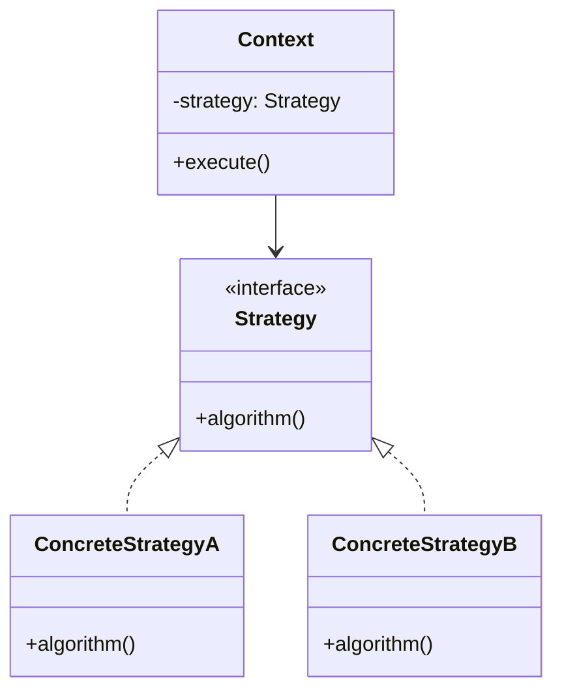

# prompt

```text
/publish 下面我们规划前端设计模式系列的第12篇文章，具体如下：
{{
## 知识点范围

### 第 11 篇：策略模式：从表单校验到 Hook 封装的算法替换术

**副标题**：把"算法"封装成可互换的对象，让调用方不知道也不关心用的是哪一种

#### 一、场景切入

- 医疗平台的药品搜索排序：可以按"价格升序"、"销量降序"、"综合评分"、"距离"排序，每种排序逻辑都是一个策略，用户切换时直接替换策略对象，排序函数本身不变
- 处方表单校验：普通处方、精神类处方、麻醉处方有不同的校验规则，用策略模式把校验规则从表单逻辑里剥离，各规则独立可测

#### 二、意图与本质

- **意图**：定义一系列算法，将每一个封装起来，并使它们可以相互替换——调用方只面向策略接口编程，不依赖具体算法实现（DIP + OCP 的直接体现）
- 解决的核心矛盾："同一功能多种算法"与"切换/新增算法不能改调用方"之间的张力

#### 三、结构与角色



- **Strategy**（策略接口）/ **ConcreteStrategy**（具体算法）/ **Context**（上下文，持有策略，委托执行）
- JavaScript 一等函数下的简化：策略不需要封装成 class，直接用函数对象 `Map<string, (data: T) => R>` 作为策略注册表

#### 四、核心实现

```typescript
// 校验策略注册表（函数式版）
type ValidateStrategy = (value: string) => string | null;
const prescriptionValidators: Record<string, ValidateStrategy> = {
  normal: (v) => v.trim() ? null : '不能为空',
  controlled: (v) => /^[A-Z]{2}\d{6}$/.test(v) ? null : '格式不符合管制药品规范',
  anesthetic: (v) => v.length >= 20 ? null : '麻醉药品处方编号不足20位',
};
function validate(type: string, value: string) {
  return prescriptionValidators[type]?.(value) ?? null;
}
```

#### 五、易混淆辨析

- **策略 vs if-else**：`if (type === 'price') sort by price; else if ...` 每新增一种排序就要改函数内部——违反 OCP；策略模式新增排序只加一个策略类，调用方零改动
- **策略 vs 状态模式**（辨析，为第 14 篇埋点）：策略模式的"策略"是由外部传入的（调用方决定用哪个），状态模式的"状态"是内部自主迁移的（对象自己管理自己用哪个）——**谁决定切换**是核心区分点

#### 六、前端工程落地

- 笔记中 jQuery `animate` 的 easing（swing/linear）是策略模式
- Zod / yup 等校验库的 schema 设计（策略模式的实际应用）
- 表单校验规则剥离（普通/管制/麻醉三种处方各自独立可测）

#### 七、面试高频问

- 策略模式和状态模式的区别是什么？（策略由外部注入，状态由内部迁移）
- 用 if-else 实现多种算法和用策略模式实现有什么本质区别？
- JavaScript 里不用 class 怎么实现策略模式？


---

## 已有笔记

- @docs\notes\11 design\05 行为模式\19 策略模式.md

## plans 地址

- @docs\plans\08 design-patterns-series-outline.md

## 规则

- 笔记只关注 @docs\notes\11 design 目录下的，其他目录禁止自行读取
- 补全内容（保留原有内容，只增不删），保留图片，一些知识点的说明图片可以从网络上获取，尽量使用图片加以说明，这样跟容易学习和理解
- 将整理后的内容生成公众号文章，输出到 @docs\articles\11 design
- 文章结构：先出大纲等我确认，再逐节写作
}}
，注意⚠️：
- 本系列 适用于 5-10年的开发者，想要系统性的学习，并且想要完全掌握 设计模式 相关 的开发者。
- 保留笔记完整代码和图片，样式格式保持一致和这篇@docs\articles\11 design\2026-10-28-uml-and-design-patterns-overview.md，不读我没要求到的文件；
- 可以根据你的经验和最佳实践查漏补缺；主线要明确清晰；每个知识点都要由浅入深的彻底讲透，讲明白。

```
