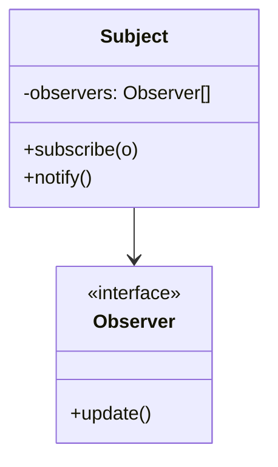
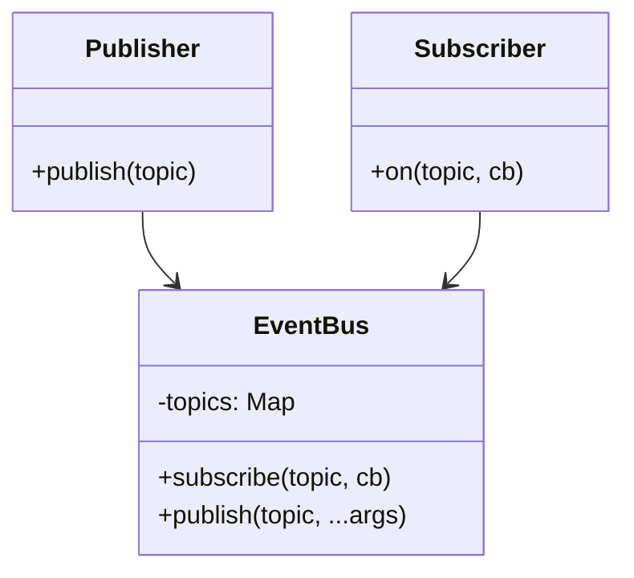

# prompt

```text
/publish 下面我们规划前端设计模式系列的第11篇文章，具体如下：
{{
## 知识点范围

### 第 11 篇：观察者与发布订阅模式：有没有中介，是解耦的分水岭

**副标题**：全系列最高频也最容易答错的一道题，这一篇彻底讲清楚

> 本篇讲两种模式的通用抽象和跨框架场景（EventEmitter、DOM 自定义事件、Redux subscribe），Vue3 `track/trigger/effect` 的具体源码实现见《Vue 3 源码》系列响应式篇，避免重复

#### 一、场景切入

- 医生修改患者病历后，页面上的"病历摘要卡片"、"用药提醒"、"随访计划"三个互不相关的组件都要联动更新——如果让病历模块直接持有这三个组件的引用去逐个调用，耦合度极高
- 医患 IM 系统里，"新消息到达"这个事件需要被聊天窗口、未读计数、通知栏三个完全不知道彼此存在的模块响应——这正是发布订阅模式要解决的问题

#### 二、意图与本质

- **观察者模式**：定义一对多的依赖关系，一个 Subject 维护一个 Observer 列表，状态变化时**直接遍历调用**每个 Observer 的更新方法——Subject 知道 Observer 的存在（持有引用），是**双方耦合**（哪怕耦合度很低）
- **发布-订阅模式**：发布者和订阅者不直接认识，通过一个中介（Event Channel / Broker / EventBus）传递消息——是**完全解耦**，两者互不知道对方存在
- 两者共同解决的问题：解耦"状态变化"和"响应状态变化的逻辑"，让新增响应逻辑不需要修改状态产生方的代码（体现 OCP）

#### 三、结构与角色

**观察者**：



**发布订阅**（多一层中介）：



#### 四、核心实现

```typescript
// 观察者模式：Subject 直接持有 Observer
interface Observer { update(data: MedicalRecord): void; }
class MedicalRecordSubject {
  private observers: Observer[] = [];
  subscribe(o: Observer) { this.observers.push(o); }
  notify(data: MedicalRecord) { this.observers.forEach(o => o.update(data)); }
}
// 发布订阅模式：经过中介 EventBus 解耦
class EventBus {
  private events = new Map<string, Array<(...args: any[]) => void>>();
  on(event: string, cb: (...args: any[]) => void) {
    (this.events.get(event) ?? this.events.set(event, []).get(event)!).push(cb);
  }
  emit(event: string, ...args: any[]) {
    this.events.get(event)?.forEach(cb => cb(...args));
  }
}
```

#### 五、易混淆辨析

- **观察者 vs 发布订阅（面试必考）**：观察者模式是 Subject 与 Observer **直接关联**（Subject.notify() 里遍历 this.observers），发布订阅模式**多了一层中介**（Publisher 和 Subscriber 都只认识 EventBus，不认识对方）——**是否存在中介、是否互相知道对方**是核心区分点
- Vue2 的 `Dep`/`Watcher` 更贴近观察者模式（Dep 直接持有 Watcher 列表并 notify）；Node.js `EventEmitter`、浏览器自定义事件、消息队列更贴近发布订阅模式（都经过一个中心化的事件通道）

#### 六、前端工程落地

- DOM `addEventListener`、Redux `store.subscribe`、Node.js `EventEmitter.on` 表面都是"订阅-通知"，但底层结构不同
- 笔记中 jQuery `Callbacks`、Vue EventBus、`http.createServer().on('request')` 都是发布订阅
- 观察者模式如何避免内存泄漏：`subscribe` 返回 `unsubscribe` 函数，组件卸载时取消订阅

#### 七、面试高频问

- 观察者模式和发布订阅模式的本质区别是什么？（是否存在中介、是否互相知道对方）
- Vue 的响应式系统属于观察者模式还是发布订阅模式？
- Node.js 的 EventEmitter 算观察者模式吗？为什么？
- 观察者模式如何避免内存泄漏（忘记 unsubscribe）？

---

## 已有笔记

- @docs\notes\11 design\04 结构型模式\10 享元模式.md

## plans 地址

- @docs\plans\08 design-patterns-series-outline.md

## 规则

- 笔记只关注 @docs\notes\11 design 目录下的，其他目录禁止自行读取
- 补全内容（保留原有内容，只增不删），保留图片，一些知识点的说明图片可以从网络上获取，尽量使用图片加以说明，这样跟容易学习和理解
- 将整理后的内容生成公众号文章，输出到 @docs\articles\11 design
- 文章结构：先出大纲等我确认，再逐节写作
}}
，注意⚠️：
- 本系列 适用于 5-10年的开发者，想要系统性的学习，并且想要完全掌握 设计模式 相关 的开发者。
- 保留笔记完整代码和图片，样式格式保持一致和这篇@docs\articles\11 design\2026-10-28-uml-and-design-patterns-overview.md，不读我没要求到的文件；
- 可以根据你的经验和最佳实践查漏补缺；主线要明确清晰；每个知识点都要由浅入深的彻底讲透，讲明白。

```
