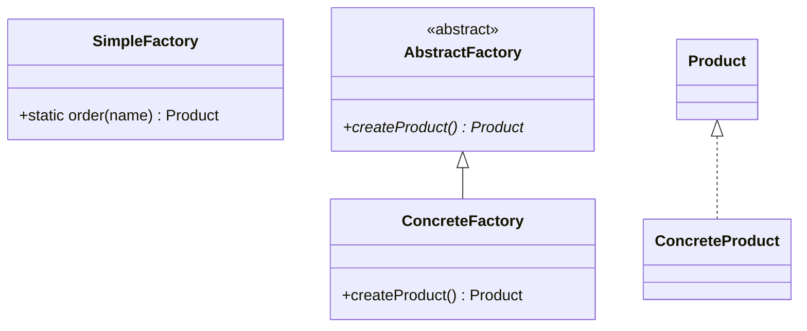
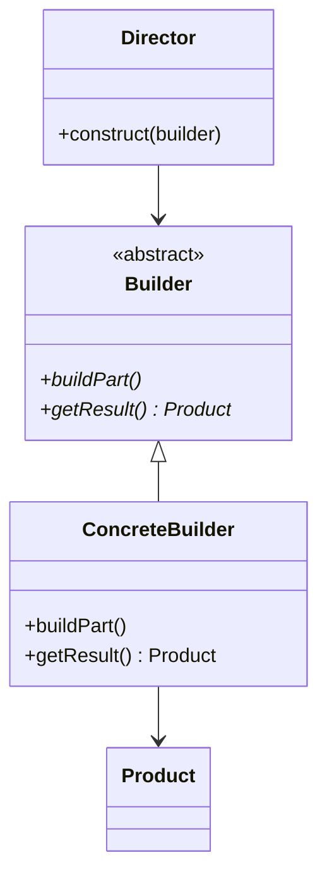

# prompt

```text
/publish 下面我们规划前端设计模式系列的第4篇文章，具体如下：
{{
## 知识点范围

### 第 04 篇：工厂与建造者模式：创建哪种对象 vs 怎么组装对象

**副标题**：工厂负责"创建哪种对象"，建造者负责"按什么步骤组装复杂对象"

#### 一、场景切入

- 医疗系统对接多家物流商（顺丰/京东/极兔），每家 SDK 接口不同，但上层只关心"给我一个快递下单器"——工厂方法模式：把实例化逻辑集中到子类，调用方只调用 `createShipper()`
- 药品详情页需要组装一个复杂 `ReportConfig` 对象（数十个字段，部分可选），直接 `new ReportConfig(field1, field2, ..., field20)` 可读性极差——建造者模式：链式 `.setTitle().setDrugId().setShowWarning().build()` 清晰且防止漏传必填字段

#### 二、意图与本质

- **工厂模式**（简单工厂/工厂方法/抽象工厂）：把"实例化哪个类"的变化点从调用方抽离，调用方只面向抽象接口编程——解决的是"创建**哪种**对象"的变化
- **建造者模式**：把复杂对象的构建过程分解为多个步骤，构建与表示分离——解决的是"**怎么**创建复杂对象"的变化

#### 三、结构与角色

**工厂系**（三个递进层次，笔记一篇收全）：



- **简单工厂**：一个工厂对象通过 switch/if 决定创建哪个产品——是函数，新增产品要改 switch，违反 OCP
- **工厂方法**：定义创建接口 `createProduct()`，子类决定实例化哪个类——新增产品只加子类，不改父类，遵守 OCP
- **抽象工厂**：生产一系列相关产品族（如 `MacUIFactory` 同时生产 `MacButton`/`MacInput`），与工厂方法区别在于产品族 vs 单一产品

**建造者**：



- 四个角色：**Product**（复杂对象）/ **Builder**（定义构建步骤）/ **ConcreteBuilder**（实现步骤）/ **Director**（控制构建顺序）
- TypeScript 中常用链式调用版本（流式建造者），省略 `Director`

#### 四、核心实现

```typescript
// 工厂方法：物流商工厂
abstract class ShipperFactory {
  abstract createShipper(): Shipper;
  ship(order: Order) { return this.createShipper().ship(order); }
}
// 建造者：药品报告配置
class ReportConfigBuilder {
  private config: Partial<ReportConfig> = {};
  setDrugId(id: string) { this.config.drugId = id; return this; }
  setShowWarning(show: boolean) { this.config.showWarning = show; return this; }
  build(): ReportConfig {
    if (!this.config.drugId) throw new Error('drugId required');
    return this.config as ReportConfig;
  }
}
```

#### 五、易混淆辨析

- **简单工厂 vs 工厂方法**：简单工厂是函数（违反 OCP），工厂方法把变化点封装进子类（遵守 OCP）——本质区别在"新增产品时改不改工厂代码"
- **工厂方法 vs 抽象工厂**：工厂方法针对"一个产品等级"，抽象工厂针对"多个产品族"——抽象工厂里包含多个工厂方法
- **建造者 vs 工厂**：工厂一次性返回完整对象（关心"创建哪种"），建造者分步骤组装（关心"怎么组装"）——参数超过 5 个且可选字段多时选建造者

#### 六、前端工程落地

- React `createElement` 是简单工厂（内部 switch 决定元素类型）
- React 早期 `createFactory(type)` 是工厂方法（`createElement.bind(null, type)`）
- jQuery `$()` 是简单工厂，`$.ajax(options)` 是建造者（options 对象分步骤装配）

#### 七、面试高频问

- 工厂方法和简单工厂有什么区别？各自违反或遵守了哪条设计原则？
- 建造者模式和工厂模式的区别是什么？什么场景下选建造者？
- 抽象工厂和工厂方法的关系是什么？


## 已有笔记

- @docs\notes\11 design\03 创建型模式\01 工厂模式.md
- @docs\notes\11 design\03 创建型模式\02 建造者模式_.md

## plans 地址

- @docs\plans\08 design-patterns-series-outline.md

## 规则

- 笔记只关注 @docs\notes\11 design 目录下的，其他目录禁止自行读取
- 补全内容（保留原有内容，只增不删），保留图片，一些知识点的说明图片可以从网络上获取，尽量使用图片加以说明，这样跟容易学习和理解
- 将整理后的内容生成公众号文章，输出到 @docs\articles\11 design
- 文章结构：先出大纲等我确认，再逐节写作
}}
，注意⚠️：
- 本系列 适用于 5-10年的开发者，想要系统性的学习，并且想要完全掌握 设计模式 相关 的开发者。
- 保留笔记完整代码和图片，样式格式保持一致和这篇@docs\articles\11 design\2026-10-28-uml-and-design-patterns-overview.md，不读我没要求到的文件；
- 可以根据你的经验和最佳实践查漏补缺；主线要明确清晰；每个知识点都要由浅入深的彻底讲透，讲明白。
```


